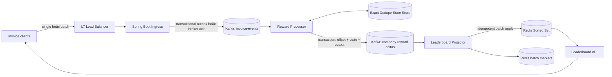

# Deep Research: Kiến trúc gamification e-Invoice cho 1.000.000 events/giây

> Generated 2026-11-26 | Depth: deep | Sources: 40

## TL;DR

Hệ thống hiện tại đã đúng và tương đối nhanh, nhưng kiến trúc “mỗi invoice → một Lua script → một Redis marker” chưa được chứng minh là phù hợp để scale tới 1M events/s. Kiến trúc đề xuất là **batch ingestion → Kafka partition → exact dedupe + aggregation → reward-delta topic → idempotent leaderboard projector → Redis Sorted Set**, tách correctness state khỏi read model và giảm số lần ghi Redis theo số company active trong mỗi time-window.

Mục tiêu 1M/s phải được xác thực bằng sustained end-to-end benchmark, không suy ra từ benchmark producer. Với 1M IDs mới mỗi giây, retention 24 giờ đã chứa **86,4 tỷ IDs**, 7 ngày chứa **604,8 tỷ IDs**; vì vậy idempotency window, state-store partitioning và archive policy là quyết định kiến trúc trung tâm.

## Executive Summary

POC Java 25/Spring Boot 4 hiện đạt khoảng 11,5k unique events/s end-to-end và leaderboard p95 2,89 ms trên local Docker, theo `docs/benchmark-results.json`. Con số này chứng minh cách tối ưu producer batching, consumer batch acknowledgment và Redis pipelining, nhưng chưa chứng minh capacity production. Kafka có các benchmark vượt 1M records/s; tuy nhiên các kết quả đó phụ thuộc mạnh vào kích thước record, replication, acknowledgment và chạy chủ yếu ở phía producer, không phải toàn bộ REST → Kafka → Redis [2][3].

Kiến trúc 1M/s cần thay đổi đơn vị công việc. Thay vì xử lý từng invoice như một thao tác Redis độc lập, hệ thống nên nhận invoice theo batch, claim idempotency trong state store phân vùng, aggregate điểm theo company trong time-window ngắn, publish delta theo transaction Kafka ở nhánh Kafka Streams hoặc state machine/outbox ở nhánh external ledger, repartition/coalesce theo company, rồi projector áp dụng delta vào Redis theo `deltaId`. Cách này giữ đúng tính idempotent nhưng giảm số Redis write từ 1M/s xuống theo số company active sau coalesce trong mỗi window.

Redis vẫn phù hợp cho leaderboard vì Sorted Set duy trì score và thứ tự với `ZINCRBY`, `ZREVRANGE`, `ZREVRANK` có độ phức tạp logarit [6][7][36]. Tuy nhiên Redis Cluster không tự chia một ZSET; toàn bộ leaderboard vẫn nằm trên một hash slot [11][12]. Vì vậy giai đoạn đầu nên dùng dedicated leaderboard Redis nhờ aggregation, và chỉ chuyển sang sharded leaderboard/materialization nếu write rate vượt capacity một shard.

Idempotency là bài toán cardinality. Ở 1M IDs/s, 15 phút là 900 triệu ID, 1 giờ là 3,6 tỷ ID, 24 giờ là 86,4 tỷ ID, 7 ngày là 604,8 tỷ ID và 30 ngày là 2,592 nghìn tỷ ID. Bloom filter có false positive nên không thể là nguồn kết luận duplicate cuối cùng [25]. Kafka Streams exactly-once chỉ bao phủ offset, state store và output Kafka, không bao gồm Redis hay REST [20][21]. Kiến trúc vì vậy sử dụng at-least-once transport kết hợp exact state claim và idempotent sink để đạt exactly-once business effect trong business window.

Cuối cùng, không có nguồn có thẩm quyền nào trong tập nghiên cứu chứng minh sustained 1M REST requests/s cho kiến trúc này. Case study 1M RPS như Zalando hữu ích nhưng không phải benchmark end-to-end tương đương [28]. Vì vậy deliverable này là kiến trúc đề xuất và capacity hypothesis, không phải tuyên bố đã đạt 1M/s. Roadmap có các gate 100k/s, 300k/s và 1M/s với soak test, failover, correctness và p95 bắt buộc.

## 1. Status Quo [Confidence: High/Medium]

### 1.1 Hiện trạng POC

POC hiện tại gồm một Spring Boot application, Kafka topic `invoice-events`, Redis Lua script và Redis Sorted Set. Mỗi invoice được claim bằng marker `PENDING`/`APPLIED`, score được tăng 10 điểm và offset chỉ được commit sau khi batch thành công. Producer đã asynchronous, consumer dùng batch acknowledgment, Redis dùng pipeline và leaderboard top-N dùng một range read.

Trước Stage 1, những tối ưu này đã được kiểm chứng bằng 25 JUnit 5 tests, benchmark direct Kafka và REST duplicate test. Khi đó đây vẫn là mô hình per-event: mỗi invoice cần lookup dedupe, marker state và ít nhất một thao tác cập nhật. Stage 1 sau đó chuyển sang batch Lua script và Redis Set với 30 tests. Ở quy mô nhỏ, chi phí này chấp nhận được; ở 1M/s, nó trở thành cả throughput bottleneck và storage-cardinality bottleneck.

### 1.2 Kafka có thể xử lý bao nhiêu

Kafka là nền tảng bất biến, phân vùng và bất đồng bộ phù hợp để tách ingest khỏi xử lý hạ lưu [1][30]. Benchmark LinkedIn từng báo cáo 2.024.032 records/s với ba producer và record chủ yếu 100 byte; cùng bài báo cáo 421.823 records/s khi dùng synchronous replication và 795.064 records/s cho workload producer + consumer [3]. Benchmark Confluent với record 1 KB, RF3 và cấu hình cụ thể đạt khoảng 605 MB/s, tương đương khoảng 605k records/s [2].

Các số này cho thấy Kafka có thể vượt 1M records/s trong một số điều kiện, nhưng không được phép suy ra rằng toàn bộ hệ thống đạt 1M/s. Record size, replication, `acks`, compression, partition distribution, broker storage và network đều thay đổi kết quả. Các benchmark chủ yếu đo producer hoặc workload Kafka cụ thể; chúng không bao gồm REST validation, exact dedupe, state-store write, aggregation, Redis apply và leaderboard read.

### 1.3 Redis phù hợp với leaderboard, nhưng không phải correctness ledger

Sorted Set là cấu trúc tự nhiên cho leaderboard: member là company, score là điểm, thứ hạng được duy trì sẵn. `ZINCRBY` và `ZREVRANK` có độ phức tạp O(log N), `ZREVRANGE` với M kết quả có O(log N + M) [6][7]. Redis cũng cung cấp pipeline để giảm round-trip cost [8].

Tuy nhiên pipeline không tạo parallel command execution. Redis chủ yếu single-threaded cho command execution [10], Lua chặn hoạt động server trong suốt script [9], và lỗi script/transaction không rollback toàn bộ write [15]. Ở 1M events/s, việc gọi Lua cho từng invoice sẽ tiêu thụ command-thread budget và khiến mọi thao tác khác xếp hàng.

### 1.4 Exactly-once phải được định nghĩa theo ranh giới

Kafka Streams có exactly-once processing cho input offset, state-store update và output topic [20][21]. Kafka transaction không thể bao gồm Redis hoặc REST API [4]. Vì vậy không nên gọi toàn hệ thống là exactly-once chỉ vì producer idempotent hoặc consumer commit transaction.

Cách định nghĩa thực tế là:

- Transport: at-least-once.
- Dedupe claim: exactly-one winner cho mỗi `invoiceId` trong retention window.
- Reward delta: exactly-once trong Kafka ở nhánh Kafka Streams; nhánh external ledger publish at-least-once nhưng idempotent về business effect.
- Redis leaderboard: idempotent theo `projectorBatchId` từ partition offset range, có thể phục hồi sau lỗi.
- Business effect: mỗi invoice chỉ tăng điểm đúng một lần trong phạm vi đã cam kết.

## 2. Emerging Trends [Confidence: Medium]

### 2.1 Kafka Streams và stateful processing

Kafka Streams đang là lựa chọn đáng cân nhắc cho xử lý stateful phân vùng. Local RocksDB state store giúp giữ dedupe/aggregation gần task, changelog topic cho phép restore [20][21]. Cách này giảm truy cập mạng cho mỗi event và cho phép transaction gồm offset + state + output.

Hạn chế là state store không tự nhỏ lại. Khi task chuyển owner, standby hoặc changelog restore có thể mất thời gian; state càng lớn, recovery càng nặng. Compaction không phải cơ chế xóa lịch sử tức thời và không thay thế retention policy rõ ràng.

### 2.2 KIP-848 và consumer group evolution

KIP-848 là bước tiến của consumer protocol nhằm cải thiện rebalance và vận hành consumer group. Không có bằng chứng trong tập nguồn rằng KIP-848 tự động tăng throughput broker; nó nên được xem là cải thiện availability/operational behavior, không phải capacity multiplier.

### 2.3 Valkey, Dragonfly và multi-threading

Valkey giữ single main thread cho command execution nhưng offload I/O [18]. Dragonfly/KeyDB có kiến trúc khác, nhưng benchmark công bằng phải normalize hardware, client, keyspace, persistence và replication. Benchmark độc lập của Two Techies cho thấy throughput realistic và fully driven có thể khác nhau lớn, và kết luận “không có người thắng phổ quát” [19].

Vì vậy việc thay Redis bằng engine multi-thread không giải quyết được hot ZSET hay correctness cardinality. Nó chỉ có ý nghĩa nếu workload thực tế được benchmark lại và cho thấy lợi ích vượt chi phí migration/operations.

### 2.4 Materialized state và top-K sharding

Khi một logical leaderboard vượt capacity một shard, mẫu phổ biến là đọc top K từ mỗi shard rồi merge toàn cục [40]. Cách này đảm bảo global top K tại snapshot nếu mỗi shard trả đúng local top K. Nó không tự cung cấp exact global rank cho mọi company và có thể có freshness lag nếu materialization bất đồng bộ.

### 2.5 Load shedding, retry budget và soak testing

AWS khuyến nghị load shedding khi hệ thống gần overload [32] và retry quota token bucket cùng jitter để tránh retry storm [33]. Grafana k6 khuyến nghị soak test dài, ví dụ 24 hoặc 48–72 giờ, để phát hiện suy giảm lâu dài [35]. `dropped_iterations` phải được báo cáo để biết load generator có thực sự duy trì offered rate hay không [34].

Đây là xu hướng vận hành quan trọng hơn việc chỉ tăng thread/partition: hệ thống 1M/s phải biết từ chối tải dư và đo đúng attempted rate.

### 2.6 Một counter-trend: Reactor Kafka discontinued

Spring đã thông báo discontinued Reactor Kafka [31]. Kiến trúc mới không nên thêm dependency này chỉ vì muốn non-blocking producer. Có thể dùng Spring Kafka blocking API trong bounded worker pool, Kafka Streams, hoặc client khác nếu benchmark chứng minh cần thiết.

## 3. Critical Assessment [Confidence: High/Medium]

### 3.1 Vì sao chỉ tune POC hiện tại không đủ

POC hiện tại có thể tăng batch, pipeline, partition và consumer concurrency, nhưng vẫn còn ba vấn đề cố hữu:

1. **Một exact lookup cho mỗi invoice.** Ở 1M/s, đây là 1M phép tra cứu/claim mỗi giây.
2. **Một correctness marker cho mỗi invoice.** Retention 24 giờ tạo ra 86,4 tỷ marker.
3. **Một hoặc nhiều Redis write cho mỗi invoice.** Dù dùng pipeline, Redis command execution vẫn tuần tự và leaderboard key có thể nóng.

Do đó mục tiêu không phải là “làm POC chạy nhanh hơn 100 lần”, mà là thay đổi đơn vị xử lý: **aggregate trước khi ghi read model**.

### 3.2 Kiến trúc đề xuất



#### Luồng xử lý

1. Client gửi single invoice hoặc batch tối đa 100–1.000 invoice.
2. Ingress validate schema, size và rate; áp dụng admission control trước khi tạo queue/buffer.
3. Event được ghi bền vững vào outbox hoặc Kafka. Nếu dùng outbox, business write và outbox insert nằm trong cùng transaction; relay publish at-least-once [24].
4. `invoice-events` dùng key bằng hash `invoiceId` để tránh hot company partition. Thứ tự company không cần thiết vì phép thưởng cộng gộp và idempotent.
5. Reward processor claim `invoiceId` trong state store. Event trùng bị bỏ qua.
6. Event mới được cộng 10 điểm vào map `companyId → deltaPoints` trong time-window 100–500 ms.
7. Processor publish `company-reward-deltas`; nhánh Kafka Streams commit offset/state/output bằng transaction, nhánh external ledger dùng `CLAIMED → EMITTED` và publish at-least-once.
8. Projector nhận delta, group theo output partition, coalesce cùng company, kiểm tra source `deltaId` markers và `projectorBatchId` từ offset range, áp dụng `ZINCRBY`, rồi finalize marker trong một Lua script. Output topology phải được giữ cố định trong pending/retry horizon hoặc drain/fence/migrate trước khi đổi partition count.
9. Leaderboard API đọc Sorted Set; top-N dùng `ZREVRANGE WITHSCORES`, company rank dùng `1 + ZCOUNT einv:leaderboard (score +inf` để có competition rank nhất quán.

#### Event schema

```json
{
  "eventId": "uuid",
  "eventType": "INVOICE_ISSUED",
  "schemaVersion": 2,
  "invoiceId": "INV-1001",
  "companyId": "COMPANY-A",
  "occurredAt": "2026-11-26T10:00:00Z",
  "source": "VNPT_EINVOICE"
}
```

```json
{
  "deltaId": "uuid",
  "eventType": "COMPANY_REWARD_DELTA",
  "schemaVersion": 1,
  "companyId": "COMPANY-A",
  "deltaPoints": 250,
  "windowStart": "2026-11-26T10:00:00Z",
  "windowEnd": "2026-11-26T10:00:00.100Z",
  "sourcePartition": 7
}
```

#### State store

Schema đề xuất cho exact claim:

```text
primary key: ((bucket), invoice_id)
fields: event_hash, status, processed_at, delta_id, event_time_day, expires_at
```

- `bucket = hash(invoice_id) mod bucket_count`; key phải stable xuyên ngày.
- `event_time_day` chỉ là field phục vụ retention/compaction, không phải một phần key khiến retry qua ngày trở thành invoice mới.
- `status = CLAIMED | EMITTED`.
- Claim phải atomic: `IF NOT EXISTS`, LWT hoặc local state transaction tương đương [22][23].
- Cùng `invoiceId` nhưng khác `eventHash` phải bị từ chối/quarantine.
- Nếu claim thành công nhưng emit delta thất bại, retry đọc lại claim và phát đúng `deltaId`, không award lần hai.

Với Kafka Streams, state store local theo partition có thể dùng RocksDB và changelog; transaction bao phủ offset, state và output [20][21]. Tuy nhiên tăng input partition count trong retention window có thể remap invoice hash sang task chưa có claim cũ. Phải giữ nguyên partition count hoặc migrate/re-shard state trước khi tăng; Stage 3 nên ưu tiên external stable ledger nếu cần đổi partition thường xuyên.

Với shared ledger Cassandra/Scylla, LWT claim không tham gia Kafka transaction. Nhánh này cần outbox/delta intent trong cùng partition transaction hoặc state machine `CLAIMED → EMITTED`, cùng `deltaId` deterministic để publish lại an toàn. LWT throughput phải được benchmark riêng; không được dùng aggregate insert benchmark để suy ra exact-claim capacity.

#### Redis keys ở kiến trúc mới

| Key | Type | Retention | Mục đích |
|---|---|---|---|
| `einv:leaderboard` | ZSET | Vĩnh viễn hoặc theo season | Company → total points |
| `einv:source-delta:{deltaId}` | String | TTL ≥ outbox republish horizon | Chống republish cùng delta ở offset mới |
| `einv:projector-batch:{partition}` | String JSON | TTL ≥ replay horizon | `PENDING`/`APPLIED`, offset range, danh sách company + `scoreBefore` |
| `einv:leaderboard-meta` | Hash | Hiện tại | `as_of`, `version`, `offset:{partition}` |
| `einv:top-cache:{limit}` | String/JSON | 50–100 ms tùy SLO | Cache top-N, có `as_of` |

Không còn một `processed:{invoiceId}` key cho mỗi invoice ở hot path. Dedupe invoice chuyển vào state store phân vùng; Redis giữ read model, source-delta markers cho horizon republish và projector batch marker theo partition. Nếu dùng Redis Cluster, leaderboard và các marker phải cùng hash tag, ví dụ `einv:{global}:leaderboard`, `einv:{global}:source-delta:{deltaId}` và `einv:{global}:projector-batch:{partition}`.

### 3.3 Capacity model

Các công thức dưới đây là planning model, không phải benchmark result.

#### Cardinality idempotency

```text
IDs = events_per_second × retention_seconds
storage_bytes ≈ IDs × bytes_per_id × replication_factor × overhead_multiplier
```

| Retention | IDs ở 1M/s | Ước lượng 50–100 byte/ID, chưa gồm index/replica |
|---|---:|---:|
| 15 phút | 900.000.000 | 45–90 GB |
| 1 giờ | 3.600.000.000 | 180–360 GB |
| 6 giờ | 21.600.000.000 | 1,08–2,16 TB |
| 24 giờ | 86.400.000.000 | 4,32–8,64 TB |
| 7 ngày | 604.800.000.000 | 30,24–60,48 TB |
| 30 ngày | 2.592.000.000.000 | 129,6–259,2 TB |

Stripe giữ idempotency key ít nhất 24 giờ [26], nhưng ở quy mô 1M/s điều đó có nghĩa là 86,4 tỷ IDs mỗi ngày. Do đó business window phải được chọn dựa trên retry/replay requirement, không mặc định “càng lâu càng tốt”.

Bảng 50–100 byte/ID chỉ là ước lượng thô cho key/value. State store thật còn có `event_hash`, `status`, `processed_at`, `delta_id`, `event_time_day`, `expires_at`, index, replication, compaction tombstone, RocksDB WAL/LSM hoặc Cassandra/Scylla storage overhead. Vì vậy không được dùng bảng này làm sizing cuối cùng; cần benchmark với schema và duplicate ratio thực.

#### Kafka storage và network

Với event trung bình 1 KB:

```text
payload = 1.000.000 × 1 KB = 1 GB/s = 8 Gbps
24h raw = 86,4 TB
RF3 raw = 259,2 TB/ngày
```

Với event trung bình 250 byte:

```text
payload = 250 MB/s = 2 Gbps
24h raw = 21,6 TB
RF3 raw = 64,8 TB/ngày
```

Các số này chưa gồm protocol overhead, index, compression gain, broker replication traffic và retention thực tế. Benchmark Confluent đạt khoảng 605 MB/s trên ba broker với cấu hình cụ thể [2]; nếu workload tương đương 1 GB/s, ước tính thô cần khoảng 5 broker ở cùng hiệu suất, và 8–12 broker để có headroom. Con số 8–12 chỉ tính input traffic; sizing thật phải cộng thêm reward-delta output, state changelog, transaction markers, internal topic và compaction. Đây là hypothesis để benchmark, không phải sizing cuối cùng.

```text
total_kafka_bytes/s = invoice_input
  + reward_delta_output
  + state_changelog
  + transaction_markers
  + internal_topics
  + replication/protocol overhead
  + consumer_fetch
  + standby/state_restore_egress
```

Broker capacity gate phải dựa trên tổng công thức này và giữ network/disk dưới 60% safe capacity đã đo, thay vì chỉ dựa vào input MB/s.

#### Redis write rate sau repartition và coalesce

Trước khi coalesce, mỗi input partition có thể tạo delta cho cùng một company. Với 64 input partitions, 100 companies và window 100 ms, preliminary delta records có thể lên tới khoảng 64.000 records/s. Vì vậy không được tính Redis write bằng global active companies nếu chưa repartition.

Sau khi output keyed `companyId` và projector coalesce cùng company:

```text
redis_zincrby_per_second ≈ sum(distinct_company_per_output_partition_per_batch) / batch_seconds
source_marker_ops_per_second ≈ preliminary_delta_records_per_second × 2
batch_marker_ops_per_second ≈ projector_batches_per_second × 2
redis_operations_per_second = zincrby + source_marker_ops + batch_marker_ops
```

Ví dụ toàn cục 1M events/s sau coalesce:

| Window | Active companies toàn cục | `ZINCRBY` writes/s |
|---|---:|---:|
| 100 ms | 100 | 1.000 |
| 100 ms | 1.000 | 10.000 |
| 100 ms | 10.000 | 100.000 |
| 500 ms | 1.000 | 2.000 |
| 500 ms | 10.000 | 20.000 |

Source-marker operations phụ thuộc preliminary delta rate, không chỉ active companies. Nếu preliminary delta rate là 64.000 records/s thì marker ops khoảng 128.000 ops/s trước khi cộng `ZINCRBY` và batch marker. Đây là lý do phải đo cả ba loại operation. Nếu mỗi window chứa 100k events toàn cục và input topic có 64 partitions, mỗi input partition chứa trung bình khoảng 1.562 events. Repartition/coalesce giảm `ZINCRBY`, còn source-delta markers bảo vệ outbox republish.

Cardinality source marker bằng `preliminary_delta_rate × republish_horizon`. Ví dụ 64.000 deltas/s và horizon 1 giờ tạo 230,4 triệu marker, khoảng 11,5–23 GB raw nếu mỗi marker 50–100 byte trước overhead. Horizon này độc lập với invoice idempotency window và phải đủ cho retry/outbox/replay, không nhất thiết phải bằng 24 giờ.

#### Consumer sizing

```text
events_per_partition = total_events / partitions
required_tasks ≈ ceil(total_events / measured_safe_events_per_task)
```

Nếu một task xử lý an toàn 20k events/s và topic có 64 partitions, cần ít nhất 64 tasks; mỗi task chịu khoảng 15.625 events/s. Nếu task chỉ chịu 10k events/s, cần tăng partition/task count hoặc giảm chi phí mỗi event. Partition count không nên tăng vô hạn vì metadata, rebalance và operational cost [5].

#### REST batching

| Events/request | HTTP requests/s cho 1M events/s |
|---:|---:|
| 1 | 1.000.000 |
| 10 | 100.000 |
| 100 | 10.000 |
| 1.000 | 1.000 |

Vì vậy batch API là đòn bẩy lớn nhất cho REST ingress. Nếu yêu cầu bắt buộc single-event 1M HTTP requests/s, chi phí TLS, connection, load balancer và Java ingress sẽ lớn hơn nhiều và cần benchmark riêng.

### 3.4 Leaderboard consistency và p95

Ở kiến trúc đề xuất, Redis nhận delta đã aggregate nên write pressure giảm mạnh. Leaderboard API vẫn có thể đọc trực tiếp một ZSET toàn cục:

- Top-N: `ZREVRANGE key 0 limit-1 WITHSCORES`.
- Points: `ZSCORE`.
- Competition rank: `1 + ZCOUNT einv:leaderboard (250 +inf` (250 là score của company).
- Tie: company cùng score cùng rank; thứ tự hiển thị deterministic theo member.

Một ZSET không được Redis Cluster tự chia [11][12]. Nếu dedicated node đủ SLO, đây là lựa chọn đơn giản nhất. Nếu không, chia theo league/region/shard rồi merge top K [40], hoặc materialize global top-N bất đồng bộ và công bố `as_of`.

Cache top-N 50–100 ms có thể giảm tail latency, nhưng phải có invalidation/version và fallback khi Redis chậm. Không nên cache nếu p95 direct read đã đạt SLO vì cache làm tăng consistency complexity.

Projector phải consume topic transactional bằng `isolation.level=read_committed`. Định danh projector batch:

```text
projectorBatchId = hash(topic, partition, firstOffset, lastOffset, schemaVersion)
```

Projector dùng cả source-delta marker và partition checkpoint. Mỗi consumer thread xử lý một output partition tuần tự. Một Lua script cho toàn bộ batch của partition thực hiện:

1. Nếu có `PENDING`, phục hồi trước bằng danh sách `deltaId` và `scoreBefore`/`scoreAfter` đã lưu.
2. Bỏ qua record có offset ≤ `lastAppliedOffset`; không yêu cầu offset liên tục vì transaction control record và aborted record tạo gap hợp lệ.
3. Với record còn lại, bỏ qua `deltaId` đã có source marker; coalesce delta mới theo company.
4. Nếu không có delta mới, chỉ cập nhật checkpoint `lastAppliedOffset = max(lastAppliedOffset, batchEnd)`.
5. Nếu có delta mới, lưu `PENDING` cùng danh sách `deltaId`, company, delta và `scoreBefore`; apply `ZINCRBY`, đánh dấu source delta, rồi finalize batch/checkpoint.

Repoll có thể trùng offset hoặc đổi batch boundary; source marker và checkpoint xử lý được. Republish cùng `deltaId` ở offset mới bị source marker chặn. Consumer position/LSO được dùng làm mốc tiến trình, không dùng phép cộng offset liên tục. Recovery bằng `scoreBefore` đúng vì mọi delta của một company nằm cùng một output partition và không có delta sau chen vào trước retry. Nếu batch listener nhận nhiều partition, phải group theo partition trước khi apply.

Output partition count cũng phải được giữ cố định trong pending/retry horizon. Nếu tăng partition, owner cũ phải drain hết pending batch, commit checkpoint, bị fence và migrate/clear pending state trước khi owner mới nhận company. Nếu không, delta mới có thể apply trước khi batch cũ recover và phá giả định `scoreBefore`/`scoreAfter`.

### 3.5 Failure recovery

| Điểm lỗi | Hành vi | Cách phục hồi |
|---|---|---|
| REST nhận request nhưng chưa ghi outbox/Kafka | Không được coi là accepted | Trả lỗi hoặc retry cùng `invoiceId` |
| Outbox publish trùng | Delta có thể trùng | Exact claim ở reward processor; source `deltaId` marker ở projector chống republish offset mới |
| Transaction control/aborted offset gap | Offset không liên tục | Bỏ qua gap; checkpoint theo consumer position/LSO, không yêu cầu `+1` |
| Claim dedupe thành công, emit delta lỗi | Offset chưa commit ở nhánh Kafka Streams | Retry đọc claim và emit lại; nhánh external LWT dùng `CLAIMED → EMITTED` |
| Kafka transaction abort | Output không visible với `read_committed` | Retry transaction |
| Projector apply Redis xong, marker chưa finalize | Có thể retry | Lua `PENDING` + `scoreBefore`/`scoreAfter` giúp nhận diện |
| Marker finalize xong, offset chưa commit | Projector đọc lại | `projectorBatchId`/`lastOffset` đã apply, bỏ qua |
| Redis mất dữ liệu | Read model mất | Rebuild từ snapshot + `company-reward-deltas` trong retention horizon |
| State store restore | Consumer tạm lag | Standby/changelog restore, đo catch-up |

Redis AOF `appendfsync everysec` có thể mất khoảng một giây khi disaster [14], replication là asynchronous [11]. Vì vậy Redis không được coi là authoritative idempotency ledger. Kafka delta topic và state store phải đủ để rebuild.

Rebuild cần một retention contract rõ ràng:

- `company-reward-deltas` phải giữ đủ horizon để replay từ snapshot gần nhất; ví dụ 7 ngày nếu snapshot hằng ngày và cần dự phòng.
- Không compact topic này chỉ theo `companyId` nếu mục tiêu là replay lịch sử; compaction có thể xóa các delta cần thiết cho tổng điểm.
- Snapshot hằng ngày lưu ZSET cùng manifest `topic → partition → lastAppliedOffset` và `as_of`; replay bắt đầu sau offset của từng partition. Một `last_delta_id` toàn cục không xác định được consistent cut trên topic nhiều partition.
- Snapshot bundle phải khôi phục được source-delta dedupe set qua barrier, hoặc quét lại delta log từ retention start tới barrier để dựng markers trước khi replay suffix. Nếu không, delta cũ đã nằm trong snapshot nhưng republish ở offset mới có thể tăng điểm lần hai.
- Marker TTL phải ≥ horizon replay tối đa; nếu marker hết hạn sớm hơn delta có thể replay, projector có thể áp dụng lại delta cũ.
- Archive lạnh có thể giữ audit lâu hơn nhưng không nằm trên hot rebuild path.

### 3.6 Các lựa chọn bị từ chối

- **Giữ Lua per-event và tăng consumer:** vẫn 1M script/s, Redis single-thread và marker cardinality không giảm.
- **Dùng Bloom filter để drop event:** false positive có thể loại nhầm invoice hợp lệ [25].
- **Dùng Kafka transaction để bao gồm Redis:** không khả thi [4].
- **Một Redis key vĩnh viễn cho mỗi invoice:** 86,4B IDs/ngày ở 1M/s, chưa tính overhead.
- **Sharded leaderboard ngay từ đầu:** aggregation có thể giữ write rate thấp; sharding sớm làm tăng freshness/rank complexity.
- **Thêm Reactor Kafka:** project đã discontinued [31].

### 3.7 SLO đề xuất

Capacity target cần được dịch thành SLI đo được. Báo cáo đề xuất:

- Durable accepted events ≥1M/s trong 30 phút.
- Processed events ≥1M/s và applied event-equivalent rate ≥1M/s trong cùng cửa sổ.
- Leaderboard p95 ≤5 ms tại 10.000 read requests/s; p99 ≤10 ms.
- Freshness p95 ≤1 giây từ Kafka accept đến Redis visible.
- Accepted invoice event RPO 0 sau Kafka/outbox commit.
- Leaderboard read model RPO ≤5 phút và RTO ≤15 phút nhờ snapshot + delta replay.
- Exact dedupe state RPO 0 trong retention window nếu replicate đúng cấu hình.

Nếu chỉ chạy 30 phút ở 1M/s thì tuyên bố phải là “1M/s capacity trong 30 phút”. Muốn tuyên bố sustained 24 giờ thì phải soak 24 giờ ở 1M/s; soak 24 giờ ở 700k/s chỉ chứng minh stability ở 700k/s. Các con số RPO/RTO trên là đề xuất để team chốt, chưa phải yêu cầu nghiệp vụ đã được phê duyệt.

## 4. Action Plan

- [ ] Chốt event size p50/p95, company cardinality, duplicate ratio và leaderboard read QPS.
- [ ] Chốt business idempotency window dựa trên retry/replay/audit, không mặc định 24 giờ.
- [ ] Implement batch ingestion 100–1.000 events/request và admission control.
- [ ] Chuyển partition key sang hash `invoiceId`; đo key skew.
- [ ] Thêm `company-reward-deltas` và reward processor aggregation.
- [ ] Spike Kafka Streams + RocksDB và Cassandra/Scylla LWT cho exact claim, restore và failover.
- [ ] Implement leaderboard projector idempotent theo source `deltaId` + `projectorBatchId`/partition checkpoint, `read_committed`, Lua atomic, offset-gap handling và marker TTL đúng horizon.
- [ ] Định nghĩa snapshot/checkpoint, source-delta dedupe reconstruction và delta retention để rebuild leaderboard.
- [ ] Tách dedicated leaderboard Redis; chưa shard cho tới khi đo cần.
- [ ] Xây dựng load test distributed với offered/accepted/durable/processed/applied rate.
- [ ] Chạy gate 100k/s, 300k/s, 1M/s theo `docs/roadmap/1m-events-roadmap.md`.
- [ ] Chạy soak 24 giờ, failover, retry storm và state restore trước khi công bố capacity.
- [ ] Hoàn thiện ADR-0001 sau khi benchmark thay đổi giả định.

## 5. Open Questions & Caveats

- Chưa có benchmark authoritative cho sustained 1M/s trên toàn bộ REST → Kafka → Redis.
- Chưa biết active company cardinality; đây là input quyết định Redis write rate sau aggregation.
- Chưa biết kích thước event và retention Kafka; 1 KB so với 250 byte thay đổi storage/network gấp bốn.
- Chưa có bằng chứng LWT/Cassandra/Scylla đạt 1M exact claims/s trên workload thực.
- Chưa có read QPS và yêu cầu exact global rank cho mọi company.
- Chưa chốt RPO/RTO và chi phí hạ tầng cho 8–12 broker, state store và archive.
- Các case study 1M RPS không tương đương kiến trúc này và một số nguồn chỉ có snippet.
- Các con số sizing trong báo cáo là planning hypothesis, phải được thay bằng benchmark thực.

## Methodology

- **Depth:** deep.
- **Wave 1:** bốn retrieval agents cho Kafka, Redis/leaderboard, idempotency/state store và end-to-end SRE/capacity.
- **Wave 2:** hai gap-fill agents cho sustained benchmark methodology, k6, Redis/Valkey methodology, Kafka Streams restoration và exact dedupe.
- **Wave 3:** một repair agent cho URL và citation thiếu.
- **Verification:** một agent kiểm tra 10 claim quan trọng; phát hiện và sửa lỗi cardinality 86,4B IDs/ngày, thay URL AWS/k6/Redis và hạ confidence cho claim chưa xác minh.
- **Synthesis:** một agent soạn bản nháp bốn vùng chuyên môn trước khi lead viết báo cáo.
- **Nguồn:** 64 nguồn thu được sau các wave; 40 nguồn mạnh nhất được giữ trong bibliography. Nguồn snippet-only được đánh dấu.
- **Outline:** bổ sung capacity model, kiến trúc đề xuất, failure recovery, ADR và roadmap vì evidence cho thấy đây là các quyết định trung tâm.
- **Hạn chế:** không chạy benchmark mới ở quy mô 1M/s; báo cáo không tuyên bố capacity production.

## Bibliography

[1] Apache Software Foundation — Apache Kafka Documentation 4.4 — https://kafka.apache.org/documentation/ — Accessed 2026-11-26 — Tier 1  
[2] Confluent Developer — Apache Kafka Performance, Latency, Throughput, and Test Results — https://developer.confluent.io/learn/kafka-performance/ — Accessed 2026-11-26 — Tier 1  
[3] Jay Kreps / LinkedIn Engineering — Benchmarking Apache Kafka: 2 Million Writes Per Second — https://engineering.linkedin.com/kafka/benchmarking-apache-kafka-2-million-writes-second-three-cheap-machines — Accessed 2026-11-26 — Tier 2, foundational  
[4] Stéphane Derosiaux / Conduktor — Kafka Exactly-Once: When It Works and When It Doesn’t — https://www.conduktor.io/blog/exactly-once-semantics-when-it-works — Accessed 2026-11-26 — Tier 2  
[5] AutoMQ — Kafka Partition Scaling Problems — https://www.automq.com/blog/kafka-partition-scaling-problems-when-more-partitions-create-more-operations-risk — Accessed 2026-11-26 — Tier 3, vendor perspective  
[6] Redis — Sorted Sets — https://redis.io/docs/latest/develop/data-types/sorted-sets/ — Accessed 2026-11-26 — Tier 1  
[7] Redis — ZREVRANK — https://redis.io/docs/latest/commands/zrevrank/ — Accessed 2026-11-26 — Tier 1  
[8] Redis — Pipelining — https://redis.io/docs/latest/develop/using-commands/pipelining/ — Accessed 2026-11-26 — Tier 1  
[9] Redis — Executing Lua in Redis — https://redis.io/docs/latest/develop/programmability/eval-intro/ — Accessed 2026-11-26 — Tier 1  
[10] Redis — Latency documentation — https://redis.io/docs/latest/operate/oss_and_stack/management/optimization/latency/ — Accessed 2026-11-26 — Tier 1  
[11] Redis — Cluster Specification — https://redis.io/docs/latest/operate/oss_and_stack/reference/cluster-spec/ — Accessed 2026-11-26 — Tier 1  
[12] Trung DLP — Redis Cluster Won’t Shard Your Hot Leaderboard — https://dev.to/trungdlp/redis-cluster-wont-shard-your-hot-leaderboard-2c4p — Accessed 2026-11-26 — Tier 2  
[13] Levelop — Build a Redis Sorted Set Leaderboard for 100M Players — https://levelop.dev/blog/100m-players-updating-scores-every-second-redis-gets-you-to-v1 — Accessed 2026-11-26 — Tier 2  
[14] Redis — Persistence — https://redis.io/docs/latest/operate/oss_and_stack/management/persistence/ — Accessed 2026-11-26 — Tier 1  
[15] Redis — Transactions — https://redis.io/docs/latest/develop/using-commands/transactions/ — Accessed 2026-11-26 — Tier 1  
[16] Redis — Benchmark — https://redis.io/docs/latest/operate/oss_and_stack/management/optimization/benchmarks/ — Accessed 2026-11-26 — Tier 1  
[17] Brahim Bouine — GCP Memorystore Redis vs AWS ElastiCache Performance Comparison — https://www.brahimbouine.com/blog/gcp-memorystore-redis-vs-elasticache/ — Accessed 2026-11-26 — Tier 2  
[18] Valkey — Performance Optimization Methodology for Valkey, Part 1 — https://valkey.io/blog/performance-optimization-methodology-for-valkey/ — Accessed 2026-11-26 — Tier 1  
[19] Two Techies — Dragonfly/Redis/Valkey Benchmark Methodology — https://two-techies.com/blog/dragonfly-redis-valkey-benchmark-methodology — Accessed 2026-11-26 — Tier 2  
[20] Apache Kafka — Streams Core Concepts — https://kafka.apache.org/44/streams/core-concepts/ — Accessed 2026-11-26 — Tier 1  
[21] Apache Kafka — Streams Developer Guide — https://kafka.apache.org/41/streams/developer-guide/ — Accessed 2026-11-26 — Tier 1  
[22] AWS — DynamoDB Working with Items and Attributes — https://docs.aws.amazon.com/amazondynamodb/latest/developerguide/WorkingWithItems.html — Accessed 2026-11-26 — Tier 1  
[23] Apache Cassandra — CQL DML and Lightweight Transactions — https://cassandra.apache.org/doc/stable/cassandra/developing/cql/dml.html#insert-and-update — Accessed 2026-11-26 — Tier 1  
[24] Chris Richardson / Microservices.io — Transactional Outbox — https://microservices.io/patterns/data/transactional-outbox.html — Accessed 2026-11-26 — Tier 1  
[25] Valkey — Bloom Filters — https://valkey.io/topics/bloomfilters/ — Accessed 2026-11-26 — Tier 1  
[26] Stripe — Idempotent Requests — https://docs.stripe.com/api/idempotent_requests — Accessed 2026-11-26 — Tier 1  
[27] Netflix Technology Blog — Real-Time Distributed Graph, Part 1 — https://netflixtechblog.com/how-and-why-netflix-built-a-real-time-distributed-graph-part-1-ingesting-and-processing-data-80113e124acc — Accessed 2026-11-26 — Tier 2, snippet only  
[28] InfoQ — How Zalando Built an In-Process Client-Side Load Balancer for One Million Requests per Second — https://www.infoq.com/news/2026/07/client-side-load-balancer/ — Accessed 2026-11-26 — Tier 2, snippet only  
[29] Vishesh Pandita / National College of Ireland — Benchmarking Java Virtual Threads in High-Throughput Workloads — https://norma.ncirl.ie/8134/1/visheshpandita.pdf — Accessed 2026-11-26 — Tier 2  
[30] Apache Kafka — 4.1 Producer Configs — https://kafka.apache.org/41/configuration/producer-configs/ — Accessed 2026-11-26 — Tier 1  
[31] Spring — Reactor Kafka Project Will Be Discontinued — https://spring.io/blog/2025/05/20/reactor-kafka-discontinued/ — Accessed 2026-11-26 — Tier 1  
[32] AWS Builders’ Library — Using Load Shedding to Avoid Overload — https://builder.aws.com/content/3Eun1EEyX6p2e3VYNyRLSJzLuMV/using-load-shedding-to-avoid-overload — Accessed 2026-11-26 — Tier 1, foundational  
[33] AWS Builders’ Library — Resilience Lessons from the Lunch Rush — https://builder.aws.com/content/3Ev17ZWA9QX88MmoaULAKevIR8H/resilience-lessons-from-the-lunch-rush — Accessed 2026-11-26 — Tier 1, foundational  
[34] Grafana k6 — Metrics Reference — https://grafana.com/docs/k6/latest/using-k6/metrics/reference/ — Accessed 2026-11-26 — Tier 1  
[35] Grafana k6 — Soak Testing — https://grafana.com/docs/k6/latest/testing-guides/test-types/soak-testing/ — Accessed 2026-11-26 — Tier 1  
[36] Redis — Leaderboard Use Case — https://redis.io/docs/latest/develop/use-cases/leaderboard/ — Accessed 2026-11-26 — Tier 1  
[37] Google SRE — Implementing SLOs — https://sre.google/workbook/implementing-slos/ — Accessed 2026-11-26 — Tier 1, foundational  
[38] Saravana Priyan C / AWS — Before Chasing High RPS: Designing a Netty Benchmark on Amazon EC2 — https://builder.aws.com/content/3KQ6baYdvpwGjpraV6ZWjd6xKaJ/before-chasing-high-rps-designing-a-netty-benchmark-on-amazon-ec2 — Accessed 2026-11-26 — Tier 1  
[39] Salvatore Sanfilippo — How Fast Is Redis? — https://github.com/pirDOL/kaka/blob/master/Opensource/How-fast-is-Redis.md — Accessed 2026-11-26 — Tier 2, foundational  
[40] Hello Interview — Design YouTube’s Top K Videos Feature — https://www.hellointerview.com/learn/system-design/problem-breakdowns/top-k — Accessed 2026-11-26 — Tier 2

## Source Extracts

### [1] Apache Kafka Documentation 4.4
- Official reference cho producer/consumer config, replication, ISR và transactions.
- Các tham số then chốt gồm `batch.size`, `linger.ms`, `compression.type`, `max.poll.records`, `enable.idempotence`, `isolation.level`.
- Dùng làm nguồn cơ chế, không dùng làm benchmark capacity.

### [2] Confluent Kafka Performance
- Benchmark ba broker `i3en.2xlarge`, RF3, record 1 KB, 100 partitions.
- Đạt khoảng 605 MB/s; ở 1 KB/record tương đương khoảng 605k records/s.
- Min-ISR 2 nghĩa là acknowledgment không nhất thiết chờ cả ba replica.

### [3] LinkedIn 2M Writes/s
- 2.024.032 records/s với ba producer, record chủ yếu 100 byte.
- Synchronous replication chỉ 421.823 records/s; combined producer/consumer 795.064 records/s.
- Chứng minh headline throughput phụ thuộc durability và workload.

### [4] Conduktor Kafka Exactly-Once
- Transaction Kafka chỉ atomic trong cluster.
- Không bao gồm database/REST/Redis; nên dùng at-least-once + idempotent sink.

### [5] AutoMQ Partition Scaling Problems
- Partition không phải parallelism miễn phí.
- Tăng partition làm tăng metadata, reassignment, recovery và hot-key risk.
- Nguồn vendor, dùng như critical perspective.

### [6] Redis Sorted Sets
- Cấu trúc duy trì score order và lexicographic tie-break.
- `ZINCRBY`, `ZREVRANK` O(log N); `ZREVRANGE` O(log N + M).

### [7] Redis ZREVRANK
- Trả về vị trí zero-based theo thứ tự giảm dần.
- Với competition rank cần đếm số score cao hơn, không dùng ordinal position.

### [8] Redis Pipelining
- Giảm RTT bằng cách gửi nhiều lệnh trước khi đọc reply.
- Không tăng parallel command execution và không cung cấp transaction isolation.

### [9] Redis Lua
- Script atomic với client khác.
- Toàn bộ server activity bị chặn trong suốt runtime script.
- Lỗi `redis.call` có thể trả về client; không có rollback ngầm.

### [10] Redis Latency
- Redis chủ yếu single-threaded cho command execution.
- Multithreaded I/O/background work không đồng nghĩa command execution song song.

### [11] Redis Cluster Specification
- 16.384 hash slots; mỗi key thuộc một slot.
- Replication asynchronous; acknowledged write có thể mất khi failover nếu không dùng cơ chế chờ replica phù hợp.

### [12] Redis Cluster Hot Leaderboard
- Hash tag giúp colocation, không giúp shard một hot key.
- Một logical leaderboard vẫn có thể nằm trên một primary.

### [13] Levelop 100M Player Leaderboard
- Đề xuất regional/shard-local leaderboard.
- Global top-N hợp nhất từ local top-N; exact global rank khó hơn.

### [14] Redis Persistence
- `appendfsync everysec` có thể mất khoảng một giây khi disaster.
- `always` bền hơn nhưng rất chậm; fork/copy-on-write có thể gây latency.

### [15] Redis Transactions
- `MULTI/EXEC` cô lập thao tác nhưng không rollback runtime error.
- Pipeline không thay thế transaction atomicity.

### [16] Redis Benchmark
- Benchmark phải mô phỏng keyspace, pipeline, client và persistence thực.
- Random-key benchmark không chứng minh hot-ZSET p95.

### [17] Managed Redis Benchmark
- Pipeline depth 10–20 có thể đạt trên 1M ops/s trên một số managed configuration.
- Không phải bằng chứng phổ quát cho hot leaderboard hoặc exact dedupe.

### [18] Valkey Performance Methodology
- Valkey giữ single main thread, offload I/O.
- Benchmark cần bare metal, pinning, loopback và workload rõ ràng.

### [19] Two Techies Benchmark Methodology
- So sánh công bằng phải normalize CPU, client, keyspace và I/O.
- Realistic throughput và fully driven throughput khác nhau lớn.
- Không có người thắng phổ quát giữa Redis/Valkey/Dragonfly.

### [20] Kafka Streams Core Concepts
- EOS bao phủ input offset, state-store update và output topic.
- Không bao gồm external side effect ngoài Kafka.

### [21] Kafka Streams Developer Guide
- RocksDB state store local theo task; changelog hỗ trợ restore.
- Standby replicas giảm downtime nhưng tốn tài nguyên và có thể lag.

### [22] DynamoDB Conditional Writes
- `attribute_not_exists` tạo first-writer-wins claim.
- Conditional failure vẫn tiêu capacity; không phải multi-item transaction.

### [23] Cassandra LWT
- `IF NOT EXISTS` và serial consistency là nền tảng exact claim.
- LWT/Paxos overhead phải được benchmark riêng.

### [24] Transactional Outbox
- Business write và outbox insert cùng transaction.
- Relay có thể publish trùng; consumer vẫn phải idempotent.

### [25] Valkey Bloom Filters
- Không có false negative nhưng có false positive.
- Positive result không chứng minh ID đã tồn tại.

### [26] Stripe Idempotent Requests
- Key tự xóa sau ít nhất 24 giờ.
- Ở 1M IDs/s, 24 giờ chứa 86,4 tỷ IDs; retention là quyết định semantics và chi phí.

### [27] Netflix Real-Time Graph
- Case study materialized state và continuous stream processing.
- Trong lần research chỉ lấy được snippet; không dùng làm throughput proof.

### [28] Zalando 1M RPS
- Case study client-side load balancer cho API khoảng 1M RPS.
- Không tương đương sustained REST → Kafka → Redis; chỉ snippet.

### [29] Java Virtual Threads Thesis
- Nghiên cứu so sánh virtual và platform threads.
- Hữu ích cho methodology, không chứng minh 1M HTTP RPS.

### [30] Kafka Producer Configs
- `batch.size`, `linger.ms`, buffer và `max.block.ms` quyết định backpressure.
- Broker backpressure có thể làm effective linger cao hơn cấu hình.

### [31] Reactor Kafka Discontinued
- Spring thông báo ngừng maintenance.
- Kiến trúc mới không nên thêm dependency này.

### [32] AWS Load Shedding
- Khi gần overload, hệ thống nên reject excess sớm.
- Autoscaling không thay thế admission control.

### [33] AWS Retry Lessons
- Dùng exponential backoff với jitter và retry quota token bucket.
- Ngăn retry storm khi dependency hoặc traffic surge.

### [34] k6 Metrics Reference
- `dropped_iterations` đếm iteration không thể start.
- Phải báo cáo cùng throughput và latency.

### [35] k6 Soak Testing
- Soak test dài hơn peak/spike.
- Ví dụ 24 giờ hoặc 48–72 giờ để phát hiện degradation.

### [36] Redis Leaderboard
- Mỗi board là một Sorted Set, member là entity, score là giá trị xếp hạng.
- Freshness và read-your-writes vẫn do application quyết định.

### [37] Google SRE Implementing SLOs
- SLO gắn với SLI và error budget.
- SLO 100% không để lại không gian cho reliability work.

### [38] AWS Netty Benchmark Caveats
- Configured offered rate không chứng minh achieved successful rate.
- Run bảy phút không chứng minh sustained capacity; phải đo interval ổn định và generator headroom.

### [39] How Fast Is Redis?
- So sánh engine phải normalize threading, hardware và workload.
- Một Redis instance không thể so trực tiếp với multi-thread store trên phần cứng khác.

### [40] Sharded Top-K
- Lấy top K từ mỗi shard rồi merge là đủ cho global top K tại snapshot.
- Không tự cung cấp exact global rank cho mọi entity.
