# VNPT e-Invoice Gamification POC — Optimized Stage 2B+

A single Spring Boot application that simulates invoice issuance, publishes `INVOICE_ISSUED` events to Kafka, deduplicates and aggregates them in a RocksDB-backed Kafka Streams topology, and applies idempotent reward deltas to a Redis leaderboard through Lua.

Stack: Java 25 (Virtual Threads), Spring Boot 4.2.0, Spring Kafka 4.2.0, Kafka 4.4.0, Kafka Streams 4.4.0, RocksDB, Redis 7.4, Micrometer/Actuator, Maven, Docker Compose, JUnit 6.1.3 & Testcontainers.

> **For learning & presenting this system:** See [SYSTEM_DESIGN_AND_DEMO_GUIDE.md](SYSTEM_DESIGN_AND_DEMO_GUIDE.md) for a complete architectural breakdown, capacity math, optimization war story, and live 10–15 minute demo playbook.

## Phase 1 — Simple system design

```mermaid
flowchart LR
    C[Client / curl] -->|single hoặc batch| API[Spring Boot REST API]
    API -->|KafkaTemplate.send, key = invoiceId| KP[Kafka Producer]
    KP -->|acks=all| KT[(Kafka: invoice-events, 12 partitions)]
    KT -->|Kafka Streams, EOS_v2, 6 threads| DS[Dedupe processor<br/>RocksDB invoice store]
    DS -->|dedupes invoiceId| WA[Window aggregator<br/>500 ms, RocksDB]
    WA -->|one delta per company per window| KD[(Kafka: company-reward-deltas)]
    KD -->|batch listener, read_committed| LP[Leaderboard projector]
    LP -->|idempotent delta batch| DL[Redis delta Lua]
    DL -->|ZINCRBY per company| ZS[(Redis Sorted Set: leaderboard)]
    API -->|GET endpoints| LS[Leaderboard Service]
    LS -->|ZREVRANGE / ZSCORE / ZCOUNT| ZS
    LS -->|points-to-discount rules| D[Discount calculation]
```



### Event-processing flow

1. `POST /api/invoices/simulate` accepts one invoice; `POST /api/invoices/batch` accepts up to 1,000 invoices.
2. The producer uses `invoiceId` as the Kafka key and returns `202 Accepted` with status `PUBLISHING` after queuing the asynchronous send.
3. Kafka Streams consumes `invoice-events` across 12 partitions with `exactly_once_v2`. The dedupe processor checks an in-heap Bloom filter and then its persistent RocksDB store keyed by `invoiceId`; an existing key is dropped before any aggregation.
4. New invoices are re-keyed to `companyId` and accumulated in a 500 ms event-time window. A wall-clock punctuator emits one `CompanyRewardDelta` per company per completed window to `company-reward-deltas`.
5. The leaderboard projector consumes the delta topic with `isolation.level=read_committed`, deduplicates delta IDs in Redis, coalesces by company, and applies `ZINCRBY` in one recoverable Lua batch.
6. Streams commits input offsets, state-store writes and output records in one Kafka transaction every 500 ms. The projector commits its batch offset only after Redis succeeds; failures redeliver and are absorbed by the delta Set and pending marker.
7. Leaderboard endpoints read Redis Sorted Sets directly. Discounts are calculated from current points.

### Kafka event JSON

```json
{
  "eventId": "83cc8e0e-26c8-4ea2-991d-a997e15b27cf",
  "eventType": "INVOICE_ISSUED",
  "schemaVersion": 1,
  "invoiceId": "INV-1001",
  "companyId": "COMPANY-A",
  "occurredAt": "2026-11-24T13:30:00Z"
}
```

- `eventId` identifies a transport message.
- `invoiceId` is the business idempotency key and the Kafka record key. A redelivery with a different `eventId` still cannot award twice.
- `companyId` is used for window aggregation and delta output. It is intentionally not the input key: dedupe locality follows the invoice identity, so a duplicate invoice always reaches the same Streams task.

### Redis keys

| Key | Type | Purpose |
|---|---|---|
| `einv:leaderboard` | Sorted Set | Member = `companyId`, score = total points |
| `einv:processed-deltas:{epochDay}` | Set (TTL) | Daily-bucketed delta IDs already applied, with automatic `EXPIRE` |
| `einv:projector-checkpoint:{topic}:{partition}` | String (TTL) | Highest applied Kafka offset per partition (tolerates EOS control/abort gaps) |
| `einv:delta-batch:{topic}:{partition}` | String JSON (TTL) | Pending leaderboard delta batch with pre-update scores for crash recovery |

Exact invoice dedupe is no longer in Redis. It lives in the Kafka Streams `invoice-dedupe-store` RocksDB state store and its changelog topic.

Company points, rank, and discount are derived from the leaderboard; no duplicate company profile is stored.

### Important decisions and trade-offs

- **Kafka-to-Kafka exactly once, Redis at-least-once with idempotent sink.** Streams uses `exactly_once_v2`, so offsets, RocksDB state and delta output commit together. Redis is outside that transaction; the projector's delta Set and recoverable Lua marker make application idempotent. There is no end-to-end exactly-once claim across Redis.
- **Asynchronous publish for ingress throughput.** The API returns after queuing the send instead of waiting for the broker. Delivery failures are logged and retries use the same `invoiceId`; production should add an outbox or delivery-status store if accepted requests must be durably retained.
- **Batch acknowledgment at the projector.** Streams owns input offsets transactionally. The Spring listener consuming `company-reward-deltas` uses `AckMode.BATCH`, so a projector crash can redeliver a batch; the delta Set absorbs it.
- **Two-stage reward pipeline.** Streams deduplicates invoices and aggregates 500 ms windows; the projector alone owns Redis Sorted Set updates.
- **One Lua call per projector batch.** Deltas are deduplicated and coalesced per company inside one atomic script execution, producing one `ZINCRBY` per company per batch.
- **Recoverable per-partition markers.** The projector stores a per-partition PENDING marker with a TTL, including pre-update scores, so a retry can distinguish “ZINCRBY did not happen” from “it happened before the marker was cleared”.
- **Minimal DLT.** Invalid event types or missing fields are filtered by the topology into `invoice-events.DLT`; valid records in the same topic are still processed.
- **Infinite retry in the POC.** A persistent Redis outage blocks the affected partition instead of skipping data. Production should use bounded retries and alerting.
- **Bounded exact dedupe with 3-bucket Bloom cache, expiration & conflict quarantine.** `DedupeProcessor` uses a bounded-retention RocksDB `WindowStore` (`24h` default) so old segments drop in O(1) disk unlink instead of growing forever, plus a 3-bucket `TimeBucketedBloomFilter` (64-bit FNV-1a character hashing + saturation fallback to RocksDB) covering the full retention window and skipping >99.999% of RocksDB reads. Expired timestamps beyond `retentionMs` are quarantined with header `x-dlt-reason=EXPIRED_INVOICE_TIMESTAMP`, and same-`invoiceId` / different-`companyId` duplicates are quarantined to `invoice-events.DLT` with `x-dlt-reason=INVOICE_COMPANY_CONFLICT`.
- **In-memory window index + deterministic `deltaId`.** `WindowAggregatorProcessor` tracks active 500 ms windows in a `TreeMap` synchronized with RocksDB (eliminating `store.all()` full scans and per-event `store.get()` calls) and emits sequence-numbered deterministic `deltaId`s (`partition:windowStart:companyId:seq`).
- **Tuned RocksDB off-heap cache & compression.** `HighThroughputRocksDBConfig` configures a shared 256 MB `LRUCache`, 16 KB blocks, native SST Bloom filters, and `LZ4` compression (`31 MB` on disk for 3.61M keys).
- **Admission control & observability.** `InvoiceEventPublisher` enforces a bounded `Semaphore` (`200,000` in-flight) returning `503 Service Unavailable` + `Retry-After: 1` when saturated, while `RewardMetrics` exposes full pipeline counters/timers at `/actuator/metrics` and `/actuator/prometheus`.
- **Single-RTT rank/summary & non-blocking Top-N micro-cache.** `rank_and_score.lua` computes `ZSCORE` + `ZCOUNT` in one round trip (powering `/rank` and `/api/companies/{id}/summary`), and `top()` uses a 50 ms single-flight stale-while-revalidate cache.

## Phase 2 — Complete working implementation

### Project structure

```text
.
├── pom.xml
├── docker-compose.yml
├── README.md
├── SYSTEM_DESIGN_AND_DEMO_GUIDE.md
├── INTERVIEW.md
├── DEEP_RESEARCH_1M_EVENTS_ARCHITECTURE.md
├── .gitignore
├── scripts/
│   ├── KafkaLoadProducer.java
│   ├── RestLoadProducer.java
│   ├── Stage3LoadBenchmark.java
│   └── load-test.mjs
├── deploy/
│   ├── docker-compose.stage3-cluster.yml
│   ├── k8s/gamification-stage3.yaml
│   ├── monitoring/
│   │   ├── gamification-alerts.yml
│   │   └── prometheus.yml
│   └── scylla/schema.cql
├── docs/
│   ├── benchmark-results.json
│   ├── adr/0001-million-event-architecture.md
│   └── roadmap/1m-events-roadmap.md
└── src/
    ├── main/
    │   ├── java/com/vnpt/einvoice/gamification/
    │   │   ├── GamificationApplication.java
    │   │   ├── api/
    │   │   │   ├── ApiErrorResponse.java
    │   │   │   ├── CompanySummaryResponse.java
    │   │   │   ├── DiscountResponse.java
    │   │   │   ├── InvoiceAcceptedResponse.java
    │   │   │   ├── InvoiceBatchAcceptedResponse.java
    │   │   │   ├── InvoiceBatchRequest.java
    │   │   │   ├── InvoiceSimulationRequest.java
    │   │   │   ├── LeaderboardEntry.java
    │   │   │   ├── LeaderboardResponse.java
    │   │   │   ├── PointsResponse.java
    │   │   │   └── RankResponse.java
    │   │   ├── config/
    │   │   │   ├── HighThroughputRocksDBConfig.java
    │   │   │   ├── KafkaConfig.java
    │   │   │   └── RewardStreamsConfig.java
    │   │   ├── event/
    │   │   │   ├── CompanyRewardDelta.java
    │   │   │   └── InvoiceIssuedEvent.java
    │   │   ├── exception/
    │   │   │   ├── ApiExceptionHandler.java
    │   │   │   ├── EventPublishException.java
    │   │   │   └── OverloadException.java
    │   │   ├── invoice/
    │   │   │   ├── InvoiceController.java
    │   │   │   ├── InvoiceEventPublisher.java
    │   │   │   └── PublishCircuitBreaker.java
    │   │   ├── leaderboard/
    │   │   │   ├── CompanyController.java
    │   │   │   ├── DiscountService.java
    │   │   │   ├── LeaderboardApplyService.java
    │   │   │   ├── LeaderboardController.java
    │   │   │   ├── LeaderboardProjector.java
    │   │   │   └── LeaderboardService.java
    │   │   ├── ledger/
    │   │   │   ├── DedupeLedger.java
    │   │   │   └── RedisLwtDedupeLedger.java
    │   │   ├── metrics/
    │   │   │   └── RewardMetrics.java
    │   │   ├── snapshot/
    │   │   │   ├── LeaderboardSnapshot.java
    │   │   │   ├── LeaderboardSnapshotService.java
    │   │   │   └── SnapshotController.java
    │   │   └── streams/
    │   │       ├── DedupeProcessor.java
    │   │       ├── RewardTopology.java
    │   │       └── WindowAggregatorProcessor.java
    │   └── resources/
    │       ├── application.yml
    │       ├── application-stage3.yml
    │       └── scripts/
    │           ├── apply_delta_batch.lua
    │           ├── claim_invoice_lwt.lua
    │           └── rank_and_score.lua
    └── test/java/com/vnpt/einvoice/gamification/
        ├── GamificationEndToEndIntegrationTest.java
        ├── Stage3ChaosAndRebuildIntegrationTest.java
        ├── config/HighThroughputRocksDBConfigTest.java
        ├── exception/ApiExceptionHandlerTest.java
        ├── invoice/
        │   ├── InvoiceEventPublisherTest.java
        │   └── PublishCircuitBreakerTest.java
        ├── leaderboard/
        │   ├── DiscountServiceTest.java
        │   ├── LeaderboardApplyServiceIntegrationTest.java
        │   ├── LeaderboardProjectorTest.java
        │   └── LeaderboardServiceTest.java
        ├── ledger/RedisLwtDedupeLedgerIntegrationTest.java
        └── streams/RewardTopologyTest.java
```

### Core implementation map

| Concern | File |
|---|---|
| Producer settings, topics and typed `KafkaTemplate` | `src/main/resources/application.yml`, `application-stage3.yml`, `src/main/java/com/vnpt/einvoice/gamification/config/KafkaConfig.java` |
| Single/batch publishing, `CircuitBreaker`, `async` / `broker-ack` | `src/main/java/com/vnpt/einvoice/gamification/invoice/InvoiceEventPublisher.java`, `PublishCircuitBreaker.java` |
| Streams runtime, `EOS_v2`, standby replicas & RocksDB tuning | `src/main/java/com/vnpt/einvoice/gamification/config/RewardStreamsConfig.java`, `HighThroughputRocksDBConfig.java` |
| Topology, DLT, 3-bucket Bloom + RocksDB / external ledger | `src/main/java/com/vnpt/einvoice/gamification/streams/RewardTopology.java`, `DedupeProcessor.java`, `WindowAggregatorProcessor.java` |
| Pluggable `CLAIMED -> EMITTED` ledger SPI + Redis CAS Lua | `src/main/java/com/vnpt/einvoice/gamification/ledger/DedupeLedger.java`, `RedisLwtDedupeLedger.java`, `claim_invoice_lwt.lua` |
| Consistent snapshot, partition-offset manifest & Kafka rebuild | `src/main/java/com/vnpt/einvoice/gamification/snapshot/LeaderboardSnapshotService.java`, `SnapshotController.java` |
| Stage 3 RF3 64-partition cluster, K8s, Scylla CQL & alerts | `deploy/docker-compose.stage3-cluster.yml`, `deploy/k8s/gamification-stage3.yaml`, `deploy/scylla/schema.cql`, `deploy/monitoring/` |
| Full E2E, chaos (`tx-abort`, wipe rebuild) & ledger tests | `Stage3ChaosAndRebuildIntegrationTest.java`, `GamificationEndToEndIntegrationTest.java`, `RedisLwtDedupeLedgerIntegrationTest.java` |

### Lua scripts

- `src/main/resources/scripts/apply_delta_batch.lua`: partition offset checkpointing, daily-bucketed TTL delta Sets, company coalescing, leaderboard update, and `PENDING` crash recovery.
- `src/main/resources/scripts/rank_and_score.lua`: single-RTT atomic `ZSCORE` + `ZCOUNT` for competition rank and `/summary`.

Both scripts execute via `EVALSHA`. Invoice dedupe is owned by the Kafka Streams RocksDB `WindowStore`, not by Redis.

## Phase 3 — Local testing

### 1. Start Kafka and Redis

```bash
docker compose up -d --wait
docker compose ps
```

Expected: both `einvoice-poc-kafka` and `einvoice-poc-redis` are healthy.

If ports 6379, 9092 or 8080 are already used by another stack, run the POC on isolated ports:

```bash
KAFKA_PORT=19092 REDIS_PORT=16379 docker compose up -d --wait
```

### 2. Start the Spring Boot application

On macOS with JDK 25 installed:

```bash
export JAVA_HOME=$(/usr/libexec/java_home -v 25)
mvn spring-boot:run
```

For the isolated-port setup:

```bash
KAFKA_BOOTSTRAP_SERVERS=localhost:19092 REDIS_PORT=16379 \
mvn spring-boot:run -Dspring-boot.run.arguments=--server.port=18080
```

The application creates `invoice-events` and `company-reward-deltas` with 12 partitions, starts a 6-thread Kafka Streams topology (application id `einvoice-reward-streams`) and a 12-listener projector consumer group. Streams creates its internal changelog topics on first start. If the topics already exist with fewer partitions, recreate them or increase the partition count before running.

### 3. Simulate an invoice

```bash
curl -i -X POST http://localhost:8080/api/invoices/simulate \
  -H 'Content-Type: application/json' \
  -d '{"invoiceId":"INV-1001","companyId":"COMPANY-A"}'
```

Expected status: `202 Accepted`.

```json
{
  "invoiceId": "INV-1001",
  "companyId": "COMPANY-A",
  "eventId": "f48add94-77d5-441f-aefd-f0133fa87169",
  "status": "PUBLISHING"
}
```

`eventId` changes on every request. `PUBLISHING` means the API queued the asynchronous Kafka send; it does not mean points are already visible.

### 4. Simulate a batch

```bash
curl -i -X POST http://localhost:8080/api/invoices/batch \
  -H 'Content-Type: application/json' \
  -d '{"invoices":[{"invoiceId":"INV-1001","companyId":"COMPANY-A"},{"invoiceId":"INV-1002","companyId":"COMPANY-A"}]}'
```

Expected:

```json
{"acceptedCount":2,"status":"PUBLISHING"}
```

### 5. Query the leaderboard

```bash
curl -s 'http://localhost:8080/api/leaderboard/top?limit=10'
```

Expected after the first event:

```json
{
  "limit": 10,
  "entries": [
    {"rank": 1, "companyId": "COMPANY-A", "points": 10}
  ]
}
```

### 6. Verify points and rank

```bash
curl -s http://localhost:8080/api/companies/COMPANY-A/points
curl -s http://localhost:8080/api/companies/COMPANY-A/rank
curl -s http://localhost:8080/api/companies/UNKNOWN/points
curl -s http://localhost:8080/api/companies/UNKNOWN/rank
```

Expected:

```json
{"companyId":"COMPANY-A","points":10}
{"companyId":"COMPANY-A","rank":1}
{"companyId":"UNKNOWN","points":0}
{"companyId":"UNKNOWN","rank":null}
```

### 7. Verify discount tiers

Unit tests cover every boundary. To exercise the API end to end, issue 10, 50, and 100 unique invoices:

```bash
seq 1 10 | xargs -P 10 -I{} curl -fsS -o /dev/null \
  -X POST http://localhost:8080/api/invoices/simulate \
  -H 'Content-Type: application/json' \
  -d '{"invoiceId":"INV-TIER-100-{}","companyId":"TIER-100"}'

seq 1 50 | xargs -P 20 -I{} curl -fsS -o /dev/null \
  -X POST http://localhost:8080/api/invoices/simulate \
  -H 'Content-Type: application/json' \
  -d '{"invoiceId":"INV-TIER-500-{}","companyId":"TIER-500"}'

seq 1 100 | xargs -P 20 -I{} curl -fsS -o /dev/null \
  -X POST http://localhost:8080/api/invoices/simulate \
  -H 'Content-Type: application/json' \
  -d '{"invoiceId":"INV-TIER-1000-{}","companyId":"TIER-1000"}'
```

Wait until consumer lag is zero:

```bash
docker compose exec -T kafka /opt/kafka/bin/kafka-consumer-groups.sh \
  --bootstrap-server localhost:9092 \
  --describe --group einvoice-gamification
```

Then query:

```bash
curl -s http://localhost:8080/api/companies/TIER-100/discount
curl -s http://localhost:8080/api/companies/TIER-500/discount
curl -s http://localhost:8080/api/companies/TIER-1000/discount
```

Expected:

```json
{"companyId":"TIER-100","points":100,"discountPercent":5}
{"companyId":"TIER-500","points":500,"discountPercent":10}
{"companyId":"TIER-1000","points":1000,"discountPercent":15}
```

### 8. Prove duplicate invoice events do not add points

```bash
curl -s -X POST http://localhost:8080/api/invoices/simulate \
  -H 'Content-Type: application/json' \
  -d '{"invoiceId":"INV-1001","companyId":"COMPANY-A"}'
```

Wait until the 500 ms window flush and the projector have run (normally under two seconds), then:

```bash
curl -s http://localhost:8080/api/companies/COMPANY-A/points
docker compose exec -T redis redis-cli ZSCORE einv:leaderboard COMPANY-A
```

Both values remain `10`. The Kafka event is new, but the invoice ID already exists in the Streams dedupe store.

### 9. Test concurrent duplicate processing

```bash
seq 1 100 | xargs -P 20 -I{} curl -fsS -o /dev/null \
  -X POST http://localhost:8080/api/invoices/simulate \
  -H 'Content-Type: application/json' \
  -d '{"invoiceId":"INV-CONCURRENT-100","companyId":"COMPANY-C"}'
```

Wait for the window flush and projector, then:

```bash
curl -s http://localhost:8080/api/companies/COMPANY-C/points
```

Expected: `{"companyId":"COMPANY-C","points":10}`.

`RewardTopologyTest` also feeds duplicate invoice IDs into the topology and asserts that only one delta is emitted. The live restart test replays an invoice that was processed before an application restart and confirms no new delta and no extra points.

### 10. Run automated tests

```bash
export JAVA_HOME=$(/usr/libexec/java_home -v 25)
mvn test
```

Expected: **56 automated tests** (`mvn test` / `mvn clean package`), 0 failures, 0 errors:
- `Stage3ChaosAndRebuildIntegrationTest` (Testcontainers real Kafka 4.4.0 + Redis 7.4): `read_committed` handling of aborted Kafka transactions + offset gaps, disaster Redis `FLUSHDB` + consistent snapshot/barrier suffix rebuild, cold Kafka retention rebuild, and batched `BROKER_ACK` durability mode.
- `RedisLwtDedupeLedgerIntegrationTest` (Testcontainers Redis 7.4 + `TopologyTestDriver`): atomic `CLAIMED -> EMITTED` Lua CAS, uncommitted offset/expired lease recovery, conflict quarantine, and partition-independent Streams topology (zero local dedupe RocksDB store).
- `GamificationEndToEndIntegrationTest` (Testcontainers real Kafka 4.4.0 + Redis 7.4 + full Spring Boot HTTP server): REST single/batch, competition ranking, discount tiers, duplicate replay, company conflict quarantine to DLT, poison-pill resilience, `kafkaStreams` Actuator health component, path-variable validation, and live Micrometer metrics.
- `LeaderboardApplyServiceIntegrationTest` (Testcontainers Redis 7.4): multi-day bucketed TTL Sets, offset checkpoint gap tolerance, atomic `PENDING` crash recovery & partial mismatch rollback rejection, zero-points Lua guard, and atomic 1-RTT `rank_and_score.lua`.
- `RewardTopologyTest`: dedupe, null/mismatched key & expired-timestamp DLT routing, conflict quarantine, multi-bucket Bloom + saturation fallback, and disk RocksDB restart restoration for dedupe & `nextEmitSeq`.
- Unit tests covering `PublishCircuitBreaker` + `BROKER_ACK`, `HighThroughputRocksDBConfig` (12-thread concurrent config & cleanup), `LeaderboardProjector` multi-partition grouping, `LeaderboardService` Top-100 slicing & cold-start single-flight cache, `InvoiceEventPublisher` partial-batch backpressure & permit safety, `DiscountService`, and `ApiExceptionHandler`.

### 11. Run the performance benchmark

Run from the project root. These commands delete all keys in the local POC Redis instance; do not point them at shared Redis.

#### Stage 2B direct Kafka benchmark

This publishes 1,000,000 unique events with the same JSON serializer and key contract (`invoiceId`) as the application, waits for every producer acknowledgment and all 10,000,000 points, then measures leaderboard p95. The output also reports the backlog at producer end and the drain rate.

```bash
mvn -q package
mvn -q dependency:build-classpath -Dmdep.outputFile=/tmp/gamification-classpath.txt
docker compose exec -T redis redis-cli FLUSHDB

java -cp "target/classes:$(cat /tmp/gamification-classpath.txt)" \
  scripts/KafkaLoadProducer.java 1000000 20 localhost:19092 invoice-events http://localhost:18080
```

A short 100,000-event run is still useful as a smoke test, but it overstates the fixed window/drain latency and is not the gate measurement.

Use `localhost:9092` and `http://localhost:8080` for the default ports.

#### REST end-to-end and duplicate benchmark

```bash
docker compose exec -T redis redis-cli FLUSHDB

TOTAL=10000 \
CONCURRENCY=100 \
COMPANIES=20 \
DUPLICATES=1000 \
LATENCY_SAMPLES=200 \
node scripts/load-test.mjs
```

The Node script publishes 10,000 unique invoice requests, waits for all points and zero Kafka lag, measures 200 leaderboard requests, republishes 1,000 existing invoice IDs, and fails if total points changed.

A bounded Java HTTP client is also available for cross-checking the Node client's ingress ceiling:

```bash
docker compose exec -T redis redis-cli FLUSHDB

java -cp "target/classes:$(cat /tmp/gamification-classpath.txt)" \
  scripts/RestLoadProducer.java 10000 200 20
```

### Measured local POC results

Environment: macOS arm64, Docker Desktop 29.7.2, Temurin Java 25.0.3, local single-node Kafka 4.4.0 and Redis 7.4 with AOF. The machine was also running other containers, so throughput variance was high.

A 100,000-event run is dominated by the fixed 500 ms window and projection drain, so the gate is measured with 1,000,000 unique events per run. Each run starts with an empty Redis and produces 10,000,000 expected points.

| Metric | Target | Optimized Pipeline (Current `HEAD`) |
|---|---:|---:|
| Direct Kafka 1M end-to-end events/s (3 runs) | 100,000 | **99,746.53 / 138,627.96 / 98,800.41** |
| Pipeline backlog drain rate | — | **175,548.56 – 201,675.94 events/s** |
| REST batch (500k events, 1,000/req) | — | **142,788.10 accepted/s**, **96,606.04 E2E/s**, **1.05 ms p95** |
| Leaderboard p95 (post-drain) | ~5 ms | **0.27 – 0.62 ms** (Direct) / **1.05 ms** (REST batch) |
| Leaderboard p95/p99 under concurrent write load | — | **13.55 – 17.19 ms p95** / **30.18 – 37.59 ms p99** (5.6k–7.0k read samples) |
| Bloom filter negative-cache accuracy (3.61M keys) | — | **3,609,996 skips / 4 false positives (99.9999%)** |
| Redis write compression (3.61M events) | — | **64,037 deltas → 1,968 Lua batches (1,834:1)** |
| RocksDB footprint (3.61M keys, LZ4) | — | **31 MB on disk** |
| Graceful restart & state restore (3.61M keys) | — | **30.41 s** (`33.97 s` earlier) `REBALANCING → RUNNING`; replay & conflict added **0 pts**, fresh invoice awarded **10 pts** |
| Under-load leaderboard p95 (post-hardening, Top-100 cache) | — | **3.54 – 8.32 ms p95** across 17.9k–24.0k concurrent reads (`0.29 – 1.06 ms` post-drain; `3,609,997 / 3,610,000` Bloom skips = **99.9999%**, `32 MB` RocksDB) |
| Automated JUnit + Testcontainers E2E & Stage 3 Chaos | — | **56/56 passed** (`-Xlint:unchecked` clean) |

#### Stage 3 Engineering Suite verification (multi-mode + disaster rebuild)

Using `scripts/Stage3LoadBenchmark.java` (Benchmark Contract reporting `offered / accepted / durable / processed / applied` rates, freshness probes, concurrent reads, and `droppedIterations`) plus `POST /api/admin/snapshots` & `/rebuild`:

| Stage 3 Mode / Drill | Measured Rate & Latency | Correctness / Recovery Proof |
|---|---|---|
| **Mode A:** `async` + `streams-rocksdb` (300k, 1,000/req) | **256.8k offered/s**, **261.1k accepted/s**, **103.6k durable/s**, **101.9k applied/s**, `0.67 ms` post-drain P95, `21.29 ms` under-load P95, `944.8 ms` freshness P50 (`1,665.8 ms` P95) | `0` 503s, `0` dropped iterations, `3,000,020` exact points, `5,000` duplicates = 0 pts |
| **Snapshot + `FLUSHDB` + Kafka Suffix Rebuild** | `583 ms` total rebuild RTO (`12` partition offsets, `4,419` delta markers restored, `120` suffix records replayed) | `3,000,020` snapshot + `10,000` suffix -> wiped to `0` -> rebuilt to **exact `3,010,020`** |
| **Mode B:** Batched `broker-ack` (`RPO=0`, `acks=all`, 200k) | **67.6k – 108.5k durable accepted/s**, **53.3k – 64.0k applied/s**, `1.24 – 1.40 ms` post-drain P95, `14.05 – 14.94 ms` under-load P95 | Virtual Threads pay 1 broker RTT per 1,000 invoices; `2,000,020–2,000,030` exact pts |
| **Mode C:** `external-ledger` (`RedisLwtDedupeLedger`, 50k) | **83.0k accepted/s**, **4.5k applied/s** (`CLAIM` + `EMIT` external Lua RTT per event, zero local RocksDB dedupe store) | Partition-independent `CLAIMED -> EMITTED` state machine; `500,010` exact pts |

Cluster production manifests (`deploy/docker-compose.stage3-cluster.yml` 3-broker RF3 64-partition Kafka KRaft, `deploy/k8s/gamification-stage3.yaml` StatefulSet/HPA, `deploy/monitoring/` Prometheus rules, `deploy/scylla/schema.cql`, and `src/main/resources/application-stage3.yml`) are ready for multi-node 300k/1M sustained hardware soak testing.

Across the three final 1M-event direct Kafka runs (concurrent with 8 HTTP leaderboard reader threads on the same Apple M4 host), end-to-end throughput measured `99,746.53`, `138,627.96`, and `98,800.41` events/s with pipeline backlog drain rates of `175k–201k` events/s, while a 500,000-event REST batch run measured `142,788.10` accepted events/s and `96,606.04` E2E events/s. Post-drain leaderboard p95 stayed at `0.27–1.05 ms` and under-load concurrent read p95 improved to `13.55–17.19 ms`.

Tuning history on the same architecture: Kafka 4.1.0 broker crashed the Streams client with KAFKA-19888; Kafka 4.4.0 fixed it. Raising commit interval from 100 ms to 500 ms reduced transaction overhead while keeping freshness under 1 s; adding a cross-DB RocksDB `WriteBufferManager` caused tiny SST flush stalls (~83 events/s) and was removed in favor of a shared 256 MB `LRUCache` + per-store memtables + `LZ4` compression; adding `O(ready)` `TreeMap` window indexing, single-flight Top-N micro-caching, and batch-level permit release lifted drain throughput to >200k/s and REST batch acceptance to 142k–195k/s.

The 15-minute sustained gate and dedicated multi-node 10,000 reads/s cluster test from the roadmap are **not** proven by these single-host Docker runs; what is proven is sustained ~100k–138k/s E2E bursts, ~200k/s pipeline drain, exact point totals, conflict/DLT routing, and clean restart state recovery.

Full machine-readable output: `docs/benchmark-results.json`.

### Remaining bottlenecks and next scaling steps

- Exact invoice dedupe lives in partition-local RocksDB `WindowStore` (bounded by `app.dedupe.retention-ms`, default 24 h). Changing `invoice-events` partition counts during an active retention window still requires state migration or switching to an external stable ledger (`ScyllaDB`/`Cassandra` LWT).
- `company-reward-deltas` is keyed by `companyId` (map-side pre-aggregated per task per 500 ms window) to avoid doubling Kafka I/O with a raw-event repartition topic; if active company cardinality exceeds tens of thousands per window, tune `window.size-ms` and partition counts together.
- On a single Docker host, producer, Spring Boot, Kafka broker, and Redis share CPU. Stage 3 scaling — 64–128 partitions across multi-broker RF3 Kafka, external LWT ledger, dedicated Redis HA, chaos failover drills, and a 30-minute 1M/s run — is detailed in `DEEP_RESEARCH_1M_EVENTS_ARCHITECTURE.md` and `docs/roadmap/1m-events-roadmap.md`.

## Validation and error behavior

- Blank or oversized request fields and empty/oversized batches return `400`.
- Malformed JSON, a non-numeric `limit`, and `limit` outside 1–100 return `400`.
- A non-JSON content type returns `415`.
- Saturated ingestion (`max-in-flight` exceeded) or Kafka producer rejection returns `503` (`Retry-After: 1` on overload).
- The API queues Kafka publishing asynchronously and returns `202` with status `PUBLISHING`; asynchronous delivery failures are logged and counted via Micrometer, so clients retry with the same `invoiceId` when needed.
- Redis read failure returns `503`.
- Projector Redis failure is not committed. The POC retries the full batch every second until processing succeeds.
- The projector consumes with `isolation.level=read_committed`, so aborted Streams transactions are not applied.
- Invalid event types, missing fields, and `INVOICE_COMPANY_CONFLICT` duplicates are routed by the topology to `invoice-events.DLT`; malformed JSON poison pills are logged and skipped via `LogAndContinueExceptionHandler` so the pipeline never stalls.

## Shutdown

```bash
# Stop the application with Ctrl+C.
docker compose down
```

`docker compose down` preserves the named Redis AOF volume. Use `docker compose down -v` only when you intentionally want to delete Kafka container data, consumer offsets, and the Redis volume.
