# VNPT e-Invoice Gamification POC — Stage 2B

A single Spring Boot application that simulates invoice issuance, publishes `INVOICE_ISSUED` events to Kafka, deduplicates and aggregates them in a Kafka Streams topology, and applies idempotent reward deltas to a Redis leaderboard through Lua.

Stack: Java 25, Spring Boot 4.2.0, Spring Kafka 4.2.0, Kafka 4.4.0, Kafka Streams 4.4.0, Redis 7.4, Maven, Docker Compose, JUnit 5.14.4.

## Phase 1 — Simple system design

```mermaid
flowchart LR
    C[Client / curl] -->|single hoặc batch| API[Spring Boot REST API]
    API -->|KafkaTemplate.send, key = invoiceId| KP[Kafka Producer]
    KP -->|acks=all| KT[(Kafka: invoice-events, 12 partitions)]
    KT -->|Kafka Streams, EOS_v2, 6 threads| DS[Dedupe processor<br/>RocksDB invoice store]
    DS -->|dedupes invoiceId| WA[Window aggregator<br/>500 ms, RocksDB]
    WA -->|one delta per company per window| KD[(Kafka: company-reward-deltas)]
    KD -->|batch listener, read_committed| LP[Leaderboard projector]
    LP -->|idempotent delta batch| DL[Redis delta Lua]
    DL -->|ZINCRBY per company| ZS[(Redis Sorted Set: leaderboard)]
    API -->|GET endpoints| LS[Leaderboard Service]
    LS -->|ZREVRANGE / ZSCORE / ZCOUNT| ZS
    LS -->|points-to-discount rules| D[Discount calculation]
```



### Event-processing flow

1. `POST /api/invoices/simulate` accepts one invoice; `POST /api/invoices/batch` accepts up to 1,000 invoices.
2. The producer uses `invoiceId` as the Kafka key and returns `202 Accepted` with status `PUBLISHING` after queuing the asynchronous send.
3. Kafka Streams consumes `invoice-events` across 12 partitions with `exactly_once_v2`. The dedupe processor checks an in-heap Bloom filter and then its persistent RocksDB store keyed by `invoiceId`; an existing key is dropped before any aggregation.
4. New invoices are re-keyed to `companyId` and accumulated in a 500 ms event-time window. A wall-clock punctuator emits one `CompanyRewardDelta` per company per completed window to `company-reward-deltas`.
5. The leaderboard projector consumes the delta topic with `isolation.level=read_committed`, deduplicates delta IDs in Redis, coalesces by company, and applies `ZINCRBY` in one recoverable Lua batch.
6. Streams commits input offsets, state-store writes and output records in one Kafka transaction every 500 ms. The projector commits its batch offset only after Redis succeeds; failures redeliver and are absorbed by the delta Set and pending marker.
7. Leaderboard endpoints read Redis Sorted Sets directly. Discounts are calculated from current points.

### Kafka event JSON

```json
{
  "eventId": "83cc8e0e-26c8-4ea2-991d-a997e15b27cf",
  "eventType": "INVOICE_ISSUED",
  "schemaVersion": 1,
  "invoiceId": "INV-1001",
  "companyId": "COMPANY-A",
  "occurredAt": "2026-11-24T13:30:00Z"
}
```

- `eventId` identifies a transport message.
- `invoiceId` is the business idempotency key and the Kafka record key. A redelivery with a different `eventId` still cannot award twice.
- `companyId` is used for window aggregation and delta output. It is intentionally not the input key: dedupe locality follows the invoice identity, so a duplicate invoice always reaches the same Streams task.

### Redis keys

| Key | Type | Purpose |
|---|---|---|
| `einv:leaderboard` | Sorted Set | Member = `companyId`, score = total points |
| `einv:processed-deltas` | Set | Company reward delta IDs already applied |
| `einv:delta-batch:{topic}:{partition}` | String JSON | Pending leaderboard delta batch with TTL |

Exact invoice dedupe is no longer in Redis. It lives in the Kafka Streams `invoice-dedupe-store` RocksDB state store and its changelog topic.

Company points, rank, and discount are derived from the leaderboard; no duplicate company profile is stored.

### Important decisions and trade-offs

- **Kafka-to-Kafka exactly once, Redis at-least-once with idempotent sink.** Streams uses `exactly_once_v2`, so offsets, RocksDB state and delta output commit together. Redis is outside that transaction; the projector's delta Set and recoverable Lua marker make application idempotent. There is no end-to-end exactly-once claim across Redis.
- **Asynchronous publish for ingress throughput.** The API returns after queuing the send instead of waiting for the broker. Delivery failures are logged and retries use the same `invoiceId`; production should add an outbox or delivery-status store if accepted requests must be durably retained.
- **Batch acknowledgment at the projector.** Streams owns input offsets transactionally. The Spring listener consuming `company-reward-deltas` uses `AckMode.BATCH`, so a projector crash can redeliver a batch; the delta Set absorbs it.
- **Two-stage reward pipeline.** Streams deduplicates invoices and aggregates 500 ms windows; the projector alone owns Redis Sorted Set updates.
- **One Lua call per projector batch.** Deltas are deduplicated and coalesced per company inside one atomic script execution, producing one `ZINCRBY` per company per batch.
- **Recoverable per-partition markers.** The projector stores a per-partition PENDING marker with a TTL, including pre-update scores, so a retry can distinguish “ZINCRBY did not happen” from “it happened before the marker was cleared”.
- **Minimal DLT.** Invalid event types or missing fields are filtered by the topology into `invoice-events.DLT`; valid records in the same topic are still processed.
- **Infinite retry in the POC.** A persistent Redis outage blocks the affected partition instead of skipping data. Production should use bounded retries and alerting.
- **Unbounded exact dedupe.** The RocksDB invoice store has no retention window yet. It is persisted and changelog-backed, but it grows with every unique invoice. A production design needs a documented business retention and a rebuild procedure, or an external ledger once partition-count changes are required.
- **Optional repartition by company.** The topology re-keys aggregated events to `companyId` without an explicit repartition topic. This keeps the POC topology small, but deltas for one company can originate from several input partitions. The projector still coalesces per batch and delta IDs are unique.
- **Redis AOF persistence.** Compose enables AOF with `appendfsync everysec` and a named volume. This is not HA and not a substitute for backups.
- **Consistent competition ranks.** `ZREVRANGE WITHSCORES` returns sorted scores, and top-N ranks are calculated from adjacent equal scores. The company-rank endpoint uses `1 + ZCOUNT key (score +inf`, so equal scores share a rank. `ZREVRANK` is O(log N) but returns an ordinal position for ties, so it is not used for the public rank semantics.
- **Twelve partitions, six Streams threads and twelve projector listeners.** Partitions bound Streams parallelism; six threads keep two partitions per thread while the projector uses one listener per delta partition. Twelve Streams threads did not improve the local benchmark and raised p95.
- **500 ms commit interval.** Streams commits offsets, state and output every 500 ms instead of the 100 ms default. This reduced transaction overhead and improved the 1M-event runs while keeping freshness within roughly one second.
- **Bloom negative cache for invoice dedupe.** Each Streams task keeps an in-heap Bloom filter of its invoice store. First-seen invoices skip the RocksDB read; a filter hit still checks the store, so false positives never drop a valid invoice. The filter is rebuilt by scanning the store on startup and costs about 8 MB per task at 4M expected keys.
- **Kafka 4.4.0 broker.** Kafka 4.1.0 brokers can crash the transaction coordinator with a negative histogram value (KAFKA-19888), which shut down the Streams client in testing. Broker 4.4.0 matches the client jars and the tested runs completed without that failure.

## Phase 2 — Complete working implementation

### Project structure

```text
.
├── pom.xml
├── docker-compose.yml
├── README.md
├── INTERVIEW.md
├── DEEP_RESEARCH_1M_EVENTS_ARCHITECTURE.md
├── .gitignore
├── scripts/
│   ├── KafkaLoadProducer.java
│   ├── RestLoadProducer.java
│   └── load-test.mjs
├── docs/
│   ├── benchmark-results.json
│   ├── adr/0001-million-event-architecture.md
│   └── roadmap/1m-events-roadmap.md
└── src/
    ├── main/
    │   ├── java/com/vnpt/einvoice/gamification/
    │   │   ├── GamificationApplication.java
    │   │   ├── api/
    │   │   │   ├── ApiErrorResponse.java
    │   │   │   ├── DiscountResponse.java
    │   │   │   ├── InvoiceAcceptedResponse.java
    │   │   │   ├── InvoiceBatchAcceptedResponse.java
    │   │   │   ├── InvoiceBatchRequest.java
    │   │   │   ├── InvoiceSimulationRequest.java
    │   │   │   ├── LeaderboardEntry.java
    │   │   │   ├── LeaderboardResponse.java
    │   │   │   ├── PointsResponse.java
    │   │   │   └── RankResponse.java
    │   │   ├── config/
    │   │   │   ├── KafkaConfig.java
    │   │   │   └── RewardStreamsConfig.java
    │   │   ├── event/
    │   │   │   ├── CompanyRewardDelta.java
    │   │   │   └── InvoiceIssuedEvent.java
    │   │   ├── exception/
    │   │   │   ├── ApiExceptionHandler.java
    │   │   │   ├── EventPublishException.java
    │   │   │   └── InvalidInvoiceEventException.java
    │   │   ├── invoice/
    │   │   │   ├── InvoiceController.java
    │   │   │   └── InvoiceEventPublisher.java
    │   │   ├── leaderboard/
    │   │   │   ├── CompanyController.java
    │   │   │   ├── DiscountService.java
    │   │   │   ├── LeaderboardApplyService.java
    │   │   │   ├── LeaderboardController.java
    │   │   │   ├── LeaderboardProjector.java
    │   │   │   └── LeaderboardService.java
    │   │   └── streams/
    │   │       ├── DedupeProcessor.java
    │   │       ├── RewardTopology.java
    │   │       └── WindowAggregatorProcessor.java
    │   └── resources/
    │       ├── application.yml
    │       └── scripts/
    │           └── apply_delta_batch.lua
    └── test/java/com/vnpt/einvoice/gamification/
        ├── exception/ApiExceptionHandlerTest.java
        ├── invoice/InvoiceEventPublisherTest.java
        ├── leaderboard/
        │   ├── DiscountServiceTest.java
        │   ├── LeaderboardApplyServiceIntegrationTest.java
        │   ├── LeaderboardProjectorTest.java
        │   └── LeaderboardServiceTest.java
        └── streams/RewardTopologyTest.java
```

### Core implementation map

| Concern | File |
|---|---|
| Producer settings and typed `KafkaTemplate` | `src/main/resources/application.yml`, `src/main/java/com/vnpt/einvoice/gamification/config/KafkaConfig.java` |
| Single and batch asynchronous publishing | `src/main/java/com/vnpt/einvoice/gamification/invoice/InvoiceEventPublisher.java` |
| Streams runtime and exactly-once config | `src/main/java/com/vnpt/einvoice/gamification/config/RewardStreamsConfig.java` |
| Topology, DLT filter, dedupe and window aggregation | `src/main/java/com/vnpt/einvoice/gamification/streams/RewardTopology.java`, `DedupeProcessor.java`, `WindowAggregatorProcessor.java` |
| Leaderboard delta projector | `src/main/java/com/vnpt/einvoice/gamification/leaderboard/LeaderboardProjector.java`, `src/main/resources/scripts/apply_delta_batch.lua` |
| Leaderboard, points, rank | `src/main/java/com/vnpt/einvoice/gamification/leaderboard/LeaderboardService.java` |
| Discount tiers | `src/main/java/com/vnpt/einvoice/gamification/leaderboard/DiscountService.java` |
| REST validation and errors | `src/main/java/com/vnpt/einvoice/gamification/exception/ApiExceptionHandler.java` |
| Streams and Redis tests | `src/test/java/com/vnpt/einvoice/gamification/streams/RewardTopologyTest.java`, `src/test/java/com/vnpt/einvoice/gamification/leaderboard/LeaderboardApplyServiceIntegrationTest.java` |

### Stage 2B Lua script

- `src/main/resources/scripts/apply_delta_batch.lua`: delta dedupe, company coalescing, leaderboard update and recovery.

The script is executed with `EVALSHA` and uses one atomic execution per Kafka batch. Invoice dedupe is owned by the Streams state store, not by Redis.

## Phase 3 — Local testing

### 1. Start Kafka and Redis

```bash
docker compose up -d --wait
docker compose ps
```

Expected: both `einvoice-poc-kafka` and `einvoice-poc-redis` are healthy.

If ports 6379, 9092 or 8080 are already used by another stack, run the POC on isolated ports:

```bash
KAFKA_PORT=19092 REDIS_PORT=16379 docker compose up -d --wait
```

### 2. Start the Spring Boot application

On macOS with JDK 25 installed:

```bash
export JAVA_HOME=$(/usr/libexec/java_home -v 25)
mvn spring-boot:run
```

For the isolated-port setup:

```bash
KAFKA_BOOTSTRAP_SERVERS=localhost:19092 REDIS_PORT=16379 \
mvn spring-boot:run -Dspring-boot.run.arguments=--server.port=18080
```

The application creates `invoice-events` and `company-reward-deltas` with 12 partitions, starts a 6-thread Kafka Streams topology (application id `einvoice-reward-streams`) and a 12-listener projector consumer group. Streams creates its internal changelog topics on first start. If the topics already exist with fewer partitions, recreate them or increase the partition count before running.

### 3. Simulate an invoice

```bash
curl -i -X POST http://localhost:8080/api/invoices/simulate \
  -H 'Content-Type: application/json' \
  -d '{"invoiceId":"INV-1001","companyId":"COMPANY-A"}'
```

Expected status: `202 Accepted`.

```json
{
  "invoiceId": "INV-1001",
  "companyId": "COMPANY-A",
  "eventId": "f48add94-77d5-441f-aefd-f0133fa87169",
  "status": "PUBLISHING"
}
```

`eventId` changes on every request. `PUBLISHING` means the API queued the asynchronous Kafka send; it does not mean points are already visible.

### 4. Simulate a batch

```bash
curl -i -X POST http://localhost:8080/api/invoices/batch \
  -H 'Content-Type: application/json' \
  -d '{"invoices":[{"invoiceId":"INV-1001","companyId":"COMPANY-A"},{"invoiceId":"INV-1002","companyId":"COMPANY-A"}]}'
```

Expected:

```json
{"acceptedCount":2,"status":"PUBLISHING"}
```

### 5. Query the leaderboard

```bash
curl -s 'http://localhost:8080/api/leaderboard/top?limit=10'
```

Expected after the first event:

```json
{
  "limit": 10,
  "entries": [
    {"rank": 1, "companyId": "COMPANY-A", "points": 10}
  ]
}
```

### 6. Verify points and rank

```bash
curl -s http://localhost:8080/api/companies/COMPANY-A/points
curl -s http://localhost:8080/api/companies/COMPANY-A/rank
curl -s http://localhost:8080/api/companies/UNKNOWN/points
curl -s http://localhost:8080/api/companies/UNKNOWN/rank
```

Expected:

```json
{"companyId":"COMPANY-A","points":10}
{"companyId":"COMPANY-A","rank":1}
{"companyId":"UNKNOWN","points":0}
{"companyId":"UNKNOWN","rank":null}
```

### 7. Verify discount tiers

Unit tests cover every boundary. To exercise the API end to end, issue 10, 50, and 100 unique invoices:

```bash
seq 1 10 | xargs -P 10 -I{} curl -fsS -o /dev/null \
  -X POST http://localhost:8080/api/invoices/simulate \
  -H 'Content-Type: application/json' \
  -d '{"invoiceId":"INV-TIER-100-{}","companyId":"TIER-100"}'

seq 1 50 | xargs -P 20 -I{} curl -fsS -o /dev/null \
  -X POST http://localhost:8080/api/invoices/simulate \
  -H 'Content-Type: application/json' \
  -d '{"invoiceId":"INV-TIER-500-{}","companyId":"TIER-500"}'

seq 1 100 | xargs -P 20 -I{} curl -fsS -o /dev/null \
  -X POST http://localhost:8080/api/invoices/simulate \
  -H 'Content-Type: application/json' \
  -d '{"invoiceId":"INV-TIER-1000-{}","companyId":"TIER-1000"}'
```

Wait until consumer lag is zero:

```bash
docker compose exec -T kafka /opt/kafka/bin/kafka-consumer-groups.sh \
  --bootstrap-server localhost:9092 \
  --describe --group einvoice-gamification
```

Then query:

```bash
curl -s http://localhost:8080/api/companies/TIER-100/discount
curl -s http://localhost:8080/api/companies/TIER-500/discount
curl -s http://localhost:8080/api/companies/TIER-1000/discount
```

Expected:

```json
{"companyId":"TIER-100","points":100,"discountPercent":5}
{"companyId":"TIER-500","points":500,"discountPercent":10}
{"companyId":"TIER-1000","points":1000,"discountPercent":15}
```

### 8. Prove duplicate invoice events do not add points

```bash
curl -s -X POST http://localhost:8080/api/invoices/simulate \
  -H 'Content-Type: application/json' \
  -d '{"invoiceId":"INV-1001","companyId":"COMPANY-A"}'
```

Wait until the 500 ms window flush and the projector have run (normally under two seconds), then:

```bash
curl -s http://localhost:8080/api/companies/COMPANY-A/points
docker compose exec -T redis redis-cli ZSCORE einv:leaderboard COMPANY-A
```

Both values remain `10`. The Kafka event is new, but the invoice ID already exists in the Streams dedupe store.

### 9. Test concurrent duplicate processing

```bash
seq 1 100 | xargs -P 20 -I{} curl -fsS -o /dev/null \
  -X POST http://localhost:8080/api/invoices/simulate \
  -H 'Content-Type: application/json' \
  -d '{"invoiceId":"INV-CONCURRENT-100","companyId":"COMPANY-C"}'
```

Wait for the window flush and projector, then:

```bash
curl -s http://localhost:8080/api/companies/COMPANY-C/points
```

Expected: `{"companyId":"COMPANY-C","points":10}`.

`RewardTopologyTest` also feeds duplicate invoice IDs into the topology and asserts that only one delta is emitted. The live restart test replays an invoice that was processed before an application restart and confirms no new delta and no extra points.

### 10. Run automated tests

```bash
export JAVA_HOME=$(/usr/libexec/java_home -v 25)
mvn test
```

Expected: **23 JUnit 5 tests**, 0 failures, 0 errors. Testcontainers covers delta Lua dedupe/aggregation/recovery against real Redis. `TopologyTestDriver` covers invoice dedupe, 500 ms window aggregation, the DLT filter and the delta output contract. The projector test covers batch handoff and invalid-delta skipping.

### 11. Run the performance benchmark

Run from the project root. These commands delete all keys in the local POC Redis instance; do not point them at shared Redis.

#### Stage 2B direct Kafka benchmark

This publishes 1,000,000 unique events with the same JSON serializer and key contract (`invoiceId`) as the application, waits for every producer acknowledgment and all 10,000,000 points, then measures leaderboard p95. The output also reports the backlog at producer end and the drain rate.

```bash
mvn -q package
mvn -q dependency:build-classpath -Dmdep.outputFile=/tmp/gamification-classpath.txt
docker compose exec -T redis redis-cli FLUSHDB

java -cp "target/classes:$(cat /tmp/gamification-classpath.txt)" \
  scripts/KafkaLoadProducer.java 1000000 20 localhost:19092 invoice-events http://localhost:18080
```

A short 100,000-event run is still useful as a smoke test, but it overstates the fixed window/drain latency and is not the gate measurement.

Use `localhost:9092` and `http://localhost:8080` for the default ports.

#### REST end-to-end and duplicate benchmark

```bash
docker compose exec -T redis redis-cli FLUSHDB

TOTAL=10000 \
CONCURRENCY=100 \
COMPANIES=20 \
DUPLICATES=1000 \
LATENCY_SAMPLES=200 \
node scripts/load-test.mjs
```

The Node script publishes 10,000 unique invoice requests, waits for all points and zero Kafka lag, measures 200 leaderboard requests, republishes 1,000 existing invoice IDs, and fails if total points changed.

A bounded Java HTTP client is also available for cross-checking the Node client's ingress ceiling:

```bash
docker compose exec -T redis redis-cli FLUSHDB

java -cp "target/classes:$(cat /tmp/gamification-classpath.txt)" \
  scripts/RestLoadProducer.java 10000 200 20
```

### Measured local POC results

Environment: macOS arm64, Docker Desktop 29.7.2, Temurin Java 25.0.3, local single-node Kafka 4.4.0 and Redis 7.4 with AOF. The machine was also running other containers, so throughput variance was high.

A 100,000-event run is dominated by the fixed 500 ms window and projection drain, so the gate is measured with 1,000,000 unique events per run. Each run starts with an empty Redis and produces 10,000,000 expected points.

| Metric | Target | Optimized Stage 2B |
|---|---:|---:|
| Producer-acked unique events/s | — | 116,708.38–135,115.94 |
| End-to-end unique events/s (1M per run) | 100,000 | **102,541.84 / 120,862.70 / 122,030.32** |
| Leaderboard p95 | about 5 ms | 1.28–3.00 ms post-drain |
| Correct points | 10,000,000 | passed on all 3 runs |
| Duplicate replay | no extra points | passed; duplicate batch replay produced no delta |
| Restart dedupe | no extra points | passed; 3M-key store restored in 42 s, replay produced no delta, a fresh invoice still awarded 10 points |
| JUnit 5 | — | 23/23 passed |

All three optimized runs exceeded 100k unique events/s end-to-end. During the producer phase the Streams topology trailed by 100k–161k events and then drained at 125k–187k events/s, so the measured result is limited by concurrent producer/host contention rather than a hard pipeline ceiling. An earlier backlog-only run with Kafka 4.1.0 and the 100 ms commit interval processed and applied 1M queued events at about 167k events/s.

Tuning history on the same code path: Kafka 4.1.0 broker crashed the Streams client with KAFKA-19888; Kafka 4.4.0 fixed it. A 100 ms Streams commit interval measured 102,734.92 / 122,299.60 / 119,156.55 events/s; 500 ms measured 126,016.29 / 126,000.46 / 116,491.17 events/s and was kept. Twelve Streams threads measured 103,507.25 / 120,175.13 events/s and was rejected. The dedupe Bloom cache was kept because it removes a RocksDB read per first-seen invoice; its effect is largest when the store has millions of keys.

The p95 is a post-drain sequential read, not measured under concurrent leaderboard load. The 15-minute sustained gate and 1,000 reads/s latency gate from the roadmap are **not** proven by these short runs; what is proven is that three independent 1M-event runs crossed 100k/s with exact point totals and no duplicate effects.

Full machine-readable output: `docs/benchmark-results.json`.

### Remaining bottlenecks and next scaling steps

- The dedupe store has no retention window. At 1M/s a day of invoice IDs is 86.4 billion keys; the store needs a documented business TTL or an external ledger before claiming that scale. The local 3M-key store used about 70 MB on disk.
- Each Streams task keeps an 8 MB Bloom filter and rebuilds it by scanning the store on startup; restore time grows with state size (42 s for 3M keys locally).
- `selectKey(companyId)` does not insert a repartition topic in this POC, so one company's deltas can be spread across input partitions. A production projector should consume a company-keyed topic.
- The aggregator scans its RocksDB window store every 250 ms and emits from wall-clock punctuation. Late events are still counted, but they can be emitted after their nominal window.
- Kafka EOS covers offsets, state and delta output only. Redis application is idempotent but not transactional; the delta Set grows with every delta and only pending markers have a TTL.
- The local producer, application, Redis and unrelated containers share CPU. Twelve partitions and six Streams threads are a Stage 2 POC choice, not a 1M/s design. A 15-minute sustained run, concurrent-read p95, freshness and failover drills remain open.

Stage 3 scaling steps — larger partition counts, partitioned exact state with expiry, repartition/coalescing, dedicated leaderboard infrastructure and a 1M/s capacity run — are in `DEEP_RESEARCH_1M_EVENTS_ARCHITECTURE.md` and `docs/roadmap/1m-events-roadmap.md`.

## Validation and error behavior

- Blank or oversized request fields and empty/oversized batches return `400`.
- Malformed JSON, a non-numeric `limit`, and `limit` outside 1–100 return `400`.
- A non-JSON content type returns `415`.
- The API queues Kafka publishing asynchronously and returns `202` with status `PUBLISHING`; asynchronous delivery failures are logged, so clients retry with the same `invoiceId` when needed.
- Redis read failure returns `503`.
- Projector Redis failure is not committed. The POC retries the full batch every second until processing succeeds.
- The projector consumes with `isolation.level=read_committed`, so aborted Streams transactions are not applied.
- Invalid event types or missing fields are routed by the topology to `invoice-events.DLT`; Kafka deserialization failures still require operations follow-up.

## Shutdown

```bash
# Stop the application with Ctrl+C.
docker compose down
```

`docker compose down` preserves the named Redis AOF volume. Use `docker compose down -v` only when you intentionally want to delete Kafka container data, consumer offsets, and the Redis volume.
