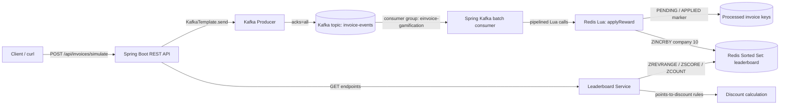

# VNPT e-Invoice Gamification POC

A single Spring Boot application that simulates invoice issuance, publishes `INVOICE_ISSUED` events to Kafka, awards points idempotently through Redis Lua, and exposes a real-time company leaderboard.

Stack: Java 25, Spring Boot 4.2.0, Spring Kafka 4.2.0, Kafka 4.1.0, Redis 7.4, Maven, Docker Compose, JUnit 5.14.4.

## Phase 1 — Simple system design



### Event-processing flow

1. `POST /api/invoices/simulate` validates the request and creates an `InvoiceIssuedEvent`.
2. The producer uses `companyId` as the Kafka key and returns `202 Accepted` with status `PUBLISHING` after queuing the asynchronous send. Broker delivery failures are logged; clients retry with the same `invoiceId`.
3. Kafka stores the event in one of three partitions. A consumer group processes partitions independently.
4. The consumer validates the whole batch, then sends all `apply_reward.lua` executions through one Redis pipeline. Each script remains atomic; the pipeline removes per-event network round trips.
5. Lua atomically checks the invoice idempotency key, writes a recoverable `PENDING` marker, increments the company score by 10, and finalizes the marker as `APPLIED`.
6. The batch listener returns only after every event succeeds. Spring Kafka then commits the batch offsets. A failure redelivers the batch; already-applied events are harmless duplicates.
7. Leaderboard endpoints read Redis Sorted Sets directly. Discounts are calculated from current points.

### Kafka event JSON

```json
{
  "eventId": "83cc8e0e-26c8-4ea2-991d-a997e15b27cf",
  "eventType": "INVOICE_ISSUED",
  "schemaVersion": 1,
  "invoiceId": "INV-1001",
  "companyId": "COMPANY-A",
  "occurredAt": "2026-11-24T13:30:00Z"
}
```

- `eventId` identifies a transport message.
- `invoiceId` is the business idempotency key. A redelivery with a different `eventId` still cannot award twice.
- `companyId` is also the Kafka partition key, preserving order for one company.

### Redis keys

| Key | Type | Purpose |
|---|---|---|
| `einv:leaderboard` | Sorted Set | Member = `companyId`, score = total points |
| `einv:processed:{invoiceId}` | String | Permanent JSON marker with `PENDING` or `APPLIED` state |

Company points, rank, and discount are derived from the leaderboard; no duplicate company profile is stored.

### Important decisions and trade-offs

- **At-least-once processing, not end-to-end exactly once.** Kafka can redeliver; Redis makes the business effect idempotent. No Kafka transactions or exactly-once claim are used.
- **Asynchronous publish for ingress throughput.** The API returns after queuing the send instead of waiting for the broker. Delivery failures are logged and retries use the same `invoiceId`; production should add an outbox or delivery-status store if accepted requests must be durably retained.
- **Batch acknowledgment.** Committing every record was measurably expensive. `AckMode.BATCH` commits after the whole listener batch succeeds. If event 50 fails, events 1–49 can be redelivered, but Lua returns duplicate for them.
- **Redis pipelining.** The consumer sends up to 500 Lua executions in one pipeline. Each event is still atomic and idempotent, but the consumer no longer pays one network round trip per event. A pipeline is not a transaction; partial execution is safe because retries use the same invoice markers.
- **Infinite retry in the POC.** A persistent Redis outage or poison event blocks the affected partition instead of skipping data. Production should use bounded retries, alerting, and a dead-letter topic.
- **Permanent idempotency keys.** Correct for this POC, but memory grows with invoice count. TTL keys reduce memory only if the business accepts re-awarding events older than the TTL.
- **Recoverable Lua state.** Redis scripts are atomic with respect to other clients, but Redis does not roll back earlier writes after a runtime error. The marker stores `PENDING` plus the company's score before the update. On retry, the script distinguishes “increment not applied” from “increment applied but marker not finalized.” Company-keyed Kafka ordering and batch retry prevent another event for that company from interleaving before recovery. Inconsistent state requires reconciliation rather than a blind commit.
- **Redis AOF persistence.** Compose enables AOF with `appendfsync everysec` and a named volume. This reduces data loss across Redis restarts but is not HA and is not a substitute for backups or a production durability policy.
- **Consistent competition ranks.** `ZREVRANGE WITHSCORES` returns sorted scores, and top-N ranks are calculated from adjacent equal scores. The company-rank endpoint uses `1 + ZCOUNT((score, +inf))`, so equal scores share a rank. `ZREVRANK` is O(log N) but returns an ordinal position for ties, so it is not used for the public rank semantics.
- **Three partitions.** Enough to demonstrate parallel consumption without making the POC operationally heavy. More partitions help only if consumers and Redis can absorb more work.

## Phase 2 — Complete working implementation

### Project structure

```text
.
├── pom.xml
├── docker-compose.yml
├── README.md
├── INTERVIEW.md
├── .gitignore
├── scripts/
│   ├── KafkaLoadProducer.java
│   ├── RestLoadProducer.java
│   └── load-test.mjs
├── docs/
│   └── benchmark-results.json
└── src/
    ├── main/
    │   ├── java/com/vnpt/einvoice/gamification/
    │   │   ├── GamificationApplication.java
    │   │   ├── api/
    │   │   │   ├── ApiErrorResponse.java
    │   │   │   ├── DiscountResponse.java
    │   │   │   ├── InvoiceAcceptedResponse.java
    │   │   │   ├── InvoiceSimulationRequest.java
    │   │   │   ├── LeaderboardEntry.java
    │   │   │   ├── LeaderboardResponse.java
    │   │   │   ├── PointsResponse.java
    │   │   │   └── RankResponse.java
    │   │   ├── config/KafkaConfig.java
    │   │   ├── consumer/RewardConsumer.java
    │   │   ├── event/InvoiceIssuedEvent.java
    │   │   ├── exception/
    │   │   │   ├── ApiExceptionHandler.java
    │   │   │   ├── EventPublishException.java
    │   │   │   └── InvalidInvoiceEventException.java
    │   │   ├── invoice/
    │   │   │   ├── InvoiceController.java
    │   │   │   └── InvoiceEventPublisher.java
    │   │   ├── leaderboard/
    │   │   │   ├── CompanyController.java
    │   │   │   ├── DiscountService.java
    │   │   │   ├── LeaderboardController.java
    │   │   │   └── LeaderboardService.java
    │   │   └── reward/RewardService.java
    │   └── resources/
    │       ├── application.yml
    │       └── scripts/apply_reward.lua
    └── test/java/com/vnpt/einvoice/gamification/
        ├── consumer/RewardConsumerTest.java
        ├── exception/ApiExceptionHandlerTest.java
        ├── invoice/InvoiceEventPublisherTest.java
        ├── leaderboard/
        │   ├── DiscountServiceTest.java
        │   └── LeaderboardServiceTest.java
        └── reward/RewardServiceIntegrationTest.java
```

### Core implementation map

| Concern | File |
|---|---|
| Producer settings and typed `KafkaTemplate` | `src/main/resources/application.yml`, `src/main/java/com/vnpt/einvoice/gamification/config/KafkaConfig.java` |
| Event publishing and broker-ack wait | `src/main/java/com/vnpt/einvoice/gamification/invoice/InvoiceEventPublisher.java` |
| Batch consumer and offset behavior | `src/main/java/com/vnpt/einvoice/gamification/consumer/RewardConsumer.java` |
| Atomic idempotent reward update | `src/main/resources/scripts/apply_reward.lua`, `src/main/java/com/vnpt/einvoice/gamification/reward/RewardService.java` |
| Leaderboard, points, rank | `src/main/java/com/vnpt/einvoice/gamification/leaderboard/LeaderboardService.java` |
| Discount tiers | `src/main/java/com/vnpt/einvoice/gamification/leaderboard/DiscountService.java` |
| REST validation and errors | `src/main/java/com/vnpt/einvoice/gamification/exception/ApiExceptionHandler.java` |
| Real Redis concurrency test | `src/test/java/com/vnpt/einvoice/gamification/reward/RewardServiceIntegrationTest.java` |

### Reward Lua script

```lua
local leaderboardType = redis.call('TYPE', KEYS[2])['ok']
if leaderboardType ~= 'none' and leaderboardType ~= 'zset' then
    return redis.error_reply('leaderboard key has unexpected type: ' .. leaderboardType)
end

local processedType = redis.call('TYPE', KEYS[1])['ok']
if processedType ~= 'none' and processedType ~= 'string' then
    return redis.error_reply('processed invoice key has unexpected type: ' .. processedType)
end

local companyId = ARGV[2]
local points = tonumber(ARGV[3])
if not points or points <= 0 then
    return redis.error_reply('points must be a positive number')
end

local markerValue = redis.call('GET', KEYS[1])
local marker = nil
if markerValue then
    local ok, decoded = pcall(cjson.decode, markerValue)
    if not ok or type(decoded) ~= 'table' then
        return redis.error_reply('processed invoice marker is malformed')
    end
    marker = decoded
end

if marker and marker.state == 'APPLIED' then
    return 0
end

if marker then
    if marker.state ~= 'PENDING'
        or marker.companyId ~= companyId
        or tonumber(marker.points) ~= points
        or not tonumber(marker.scoreBefore) then
        return redis.error_reply('processed invoice marker has unexpected state')
    end
end

local scoreValue = redis.call('ZSCORE', KEYS[2], companyId)
local currentScore = scoreValue and tonumber(scoreValue) or 0

if marker then
    local scoreBefore = tonumber(marker.scoreBefore)
    local scoreAfter = scoreBefore + points
    if currentScore == scoreAfter then
        redis.call('SET', KEYS[1], cjson.encode({
            state = 'APPLIED',
            companyId = companyId,
            points = points
        }))
        return 1
    end

    if currentScore == scoreBefore then
        redis.call('ZINCRBY', KEYS[2], points, companyId)
        redis.call('SET', KEYS[1], cjson.encode({
            state = 'APPLIED',
            companyId = companyId,
            points = points
        }))
        return 1
    end

    return redis.error_reply('partial reward state requires reconciliation')
end

redis.call('SET', KEYS[1], cjson.encode({
    state = 'PENDING',
    companyId = companyId,
    points = points,
    scoreBefore = currentScore
}))
redis.call('ZINCRBY', KEYS[2], points, companyId)
redis.call('SET', KEYS[1], cjson.encode({
    state = 'APPLIED',
    companyId = companyId,
    points = points
}))
return 1
```

## Phase 3 — Local testing

### 1. Start Kafka and Redis

```bash
docker compose up -d --wait
docker compose ps
```

Expected: both `einvoice-poc-kafka` and `einvoice-poc-redis` are healthy.

### 2. Start the Spring Boot application

On macOS with JDK 25 installed:

```bash
export JAVA_HOME=$(/usr/libexec/java_home -v 25)
mvn spring-boot:run
```

The application creates `invoice-events` with three partitions and starts three consumer threads.

### 3. Simulate an invoice

```bash
curl -i -X POST http://localhost:8080/api/invoices/simulate \
  -H 'Content-Type: application/json' \
  -d '{"invoiceId":"INV-1001","companyId":"COMPANY-A"}'
```

Expected status: `202 Accepted`.

```json
{
  "invoiceId": "INV-1001",
  "companyId": "COMPANY-A",
  "eventId": "f48add94-77d5-441f-aefd-f0133fa87169",
  "status": "PUBLISHING"
}
```

`eventId` changes on every request. `PUBLISHING` means the API queued the asynchronous Kafka send; it does not mean points are already visible.

### 4. Query the leaderboard

```bash
curl -s 'http://localhost:8080/api/leaderboard/top?limit=10'
```

Expected after the first event:

```json
{
  "limit": 10,
  "entries": [
    {"rank": 1, "companyId": "COMPANY-A", "points": 10}
  ]
}
```

### 5. Verify points and rank

```bash
curl -s http://localhost:8080/api/companies/COMPANY-A/points
curl -s http://localhost:8080/api/companies/COMPANY-A/rank
curl -s http://localhost:8080/api/companies/UNKNOWN/points
curl -s http://localhost:8080/api/companies/UNKNOWN/rank
```

Expected:

```json
{"companyId":"COMPANY-A","points":10}
{"companyId":"COMPANY-A","rank":1}
{"companyId":"UNKNOWN","points":0}
{"companyId":"UNKNOWN","rank":null}
```

### 6. Verify discount tiers

Unit tests cover every boundary. To exercise the API end to end, issue 10, 50, and 100 unique invoices:

```bash
seq 1 10 | xargs -P 10 -I{} curl -fsS -o /dev/null \
  -X POST http://localhost:8080/api/invoices/simulate \
  -H 'Content-Type: application/json' \
  -d '{"invoiceId":"INV-TIER-100-{}","companyId":"TIER-100"}'

seq 1 50 | xargs -P 20 -I{} curl -fsS -o /dev/null \
  -X POST http://localhost:8080/api/invoices/simulate \
  -H 'Content-Type: application/json' \
  -d '{"invoiceId":"INV-TIER-500-{}","companyId":"TIER-500"}'

seq 1 100 | xargs -P 20 -I{} curl -fsS -o /dev/null \
  -X POST http://localhost:8080/api/invoices/simulate \
  -H 'Content-Type: application/json' \
  -d '{"invoiceId":"INV-TIER-1000-{}","companyId":"TIER-1000"}'
```

Wait until consumer lag is zero:

```bash
docker compose exec -T kafka /opt/kafka/bin/kafka-consumer-groups.sh \
  --bootstrap-server localhost:9092 \
  --describe --group einvoice-gamification
```

Then query:

```bash
curl -s http://localhost:8080/api/companies/TIER-100/discount
curl -s http://localhost:8080/api/companies/TIER-500/discount
curl -s http://localhost:8080/api/companies/TIER-1000/discount
```

Expected:

```json
{"companyId":"TIER-100","points":100,"discountPercent":5}
{"companyId":"TIER-500","points":500,"discountPercent":10}
{"companyId":"TIER-1000","points":1000,"discountPercent":15}
```

### 7. Prove duplicate invoice events do not add points

```bash
curl -s -X POST http://localhost:8080/api/invoices/simulate \
  -H 'Content-Type: application/json' \
  -d '{"invoiceId":"INV-1001","companyId":"COMPANY-A"}'
```

Wait for zero lag, then:

```bash
curl -s http://localhost:8080/api/companies/COMPANY-A/points
docker compose exec -T redis redis-cli ZSCORE einv:leaderboard COMPANY-A
```

Both values remain `10`. The Kafka event is new, but the business invoice ID already exists.

### 8. Test concurrent duplicate processing

```bash
seq 1 100 | xargs -P 20 -I{} curl -fsS -o /dev/null \
  -X POST http://localhost:8080/api/invoices/simulate \
  -H 'Content-Type: application/json' \
  -d '{"invoiceId":"INV-CONCURRENT-100","companyId":"COMPANY-C"}'
```

Wait for zero lag, then:

```bash
curl -s http://localhost:8080/api/companies/COMPANY-C/points
```

Expected: `{"companyId":"COMPANY-C","points":10}`.

The JUnit integration test also submits the same event from 32 virtual threads to real Redis and asserts exactly one script reports `processed`.

### 9. Run automated tests

```bash
export JAVA_HOME=$(/usr/libexec/java_home -v 25)
mvn test
```

Expected: 25 JUnit 5 tests, 0 failures, 0 errors. The Redis integration test starts its own Redis container through Testcontainers and covers concurrent duplicates, a 300-record pipeline with 100 duplicates, and both partial-write recovery points.

### 10. Run the performance benchmark

Run from the project root. These commands delete all keys in the local POC Redis instance; do not point them at shared Redis.

#### Direct Kafka unique-event benchmark

This is the primary test for the 10,000 Kafka events/s target. It publishes 10,000 unique events with the same JSON serializer contract as the application, waits for every producer acknowledgment and all 100,000 points, then measures leaderboard p95.

```bash
mvn -q package
mvn -q dependency:build-classpath -Dmdep.outputFile=/tmp/einvoice-classpath.txt
docker compose exec -T redis redis-cli FLUSHDB

java -cp "target/classes:$(cat /tmp/einvoice-classpath.txt)" \
  scripts/KafkaLoadProducer.java 10000 20
```

#### REST end-to-end and duplicate benchmark

```bash
docker compose exec -T redis redis-cli FLUSHDB

TOTAL=10000 \
CONCURRENCY=100 \
COMPANIES=20 \
DUPLICATES=1000 \
LATENCY_SAMPLES=200 \
node scripts/load-test.mjs
```

The Node script publishes 10,000 unique invoice requests, waits for all points and zero Kafka lag, measures 200 leaderboard requests, republishes 1,000 existing invoice IDs, and fails if total points changed.

A bounded Java HTTP client is also available for cross-checking the Node client's ingress ceiling:

```bash
docker compose exec -T redis redis-cli FLUSHDB

java -cp "target/classes:$(cat /tmp/einvoice-classpath.txt)" \
  scripts/RestLoadProducer.java 10000 200 20
```

### Measured local POC results

Environment: macOS arm64, Docker Desktop 29.7.2, Temurin Java 25.0.3, local single-node Kafka and Redis with AOF. These are POC measurements, not production results.

| Metric | Target | Final measured |
|---|---:|---:|
| Direct Kafka producer-acked unique events/s | — | 23,703.57 |
| Direct Kafka end-to-end unique events/s | 10,000 | 11,513.81 |
| Direct Kafka leaderboard p95 | about 5 ms | 2.89 ms |
| Repeated direct runs | 10,000 | 11,513.81–13,622.93 events/s |
| Repeated direct p95 | about 5 ms | 1.00–2.89 ms |
| REST Node unique end-to-end events/s | — | 8,713.37 |
| REST Node leaderboard p95 | about 5 ms | 4.696 ms |
| REST duplicate correctness | no extra points | passed; 100,000 before and after |
| ApacheBench duplicate burst | — | 14,428.89 requests/s, 0 failures |

The requested **10,000 Kafka events/s** and **about 5 ms p95** targets were both met in the direct Kafka benchmark. The lower Node REST figure is a client/HTTP-ingress measurement, not the Kafka processing ceiling; ApacheBench also confirmed more than 10,000 REST requests/s under a duplicate burst. The initial per-record version measured 1,805.25 end-to-end events/s and 13.145 ms p95; Redis pipelining, asynchronous publishing, larger consumer batches, and producer tuning produced the final results.

Full machine-readable output: `docs/benchmark-results.json`.

### Likely bottlenecks and next scaling steps

- The REST simulator and load client can limit ingress before Kafka becomes the bottleneck.
- Three partitions cap consumer parallelism at three unless the topic is expanded.
- Redis is still single-threaded; larger pipelines reduce network overhead but increase per-batch blocking time.
- Permanent processed keys consume memory indefinitely.
- A very large `limit` increases response size and JSON serialization time.

To scale further: increase partitions and application instances together, tune producer batching, use multiple load-generator processes for REST testing, add capacity/eviction policy for idempotency keys, and cache top-N reads only if bounded staleness is acceptable.

## Validation and error behavior

- Blank or oversized request fields return `400`.
- Malformed JSON, a non-numeric `limit`, and `limit` outside 1–100 return `400`.
- A non-JSON content type returns `415`.
- The API queues Kafka publishing asynchronously and returns `202` with status `PUBLISHING`; asynchronous delivery failures are logged, so clients retry with the same `invoiceId` when needed.
- Redis read failure returns `503`.
- Consumer Redis failure is not committed. The POC retries the full batch every second until processing succeeds. A poison event also blocks its partition in this minimal POC; production needs a dead-letter path.

## Shutdown

```bash
# Stop the application with Ctrl+C.
docker compose down
```

`docker compose down` preserves the named Redis AOF volume. Use `docker compose down -v` only when you intentionally want to delete Kafka container data, consumer offsets, and the Redis volume.
