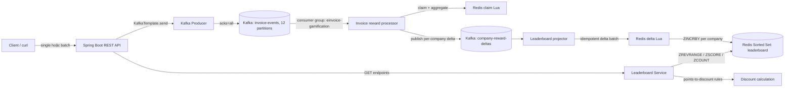

# VNPT e-Invoice Gamification POC — Stage 2A

A single Spring Boot application that simulates invoice issuance, publishes `INVOICE_ISSUED` events to Kafka, awards points idempotently through Redis Lua, and exposes a real-time company leaderboard.

Stack: Java 25, Spring Boot 4.2.0, Spring Kafka 4.2.0, Kafka 4.1.0, Redis 7.4, Maven, Docker Compose, JUnit 5.14.4.

## Phase 1 — Simple system design



### Event-processing flow

1. `POST /api/invoices/simulate` accepts one invoice; `POST /api/invoices/batch` accepts up to 1,000 invoices.
2. The producer uses `companyId` as the Kafka key and returns `202 Accepted` with status `PUBLISHING` after queuing the asynchronous send.
3. Kafka stores events across 12 partitions. A consumer group processes partitions independently.
4. The consumer validates the whole Kafka batch and creates a deterministic batch ID from topic, partition and offset range.
5. The invoice processor claims IDs with a recoverable Redis Lua batch, aggregates points per company, publishes one `CompanyRewardDelta` per company to Kafka, then deletes the claim marker.
6. The leaderboard projector consumes the delta topic, checks/deduplicates delta IDs in Redis, coalesces by company, and applies `ZINCRBY` in one recoverable Lua batch.
7. Batch offsets commit only after each listener succeeds. Failures redeliver; claim/delta markers and processed Sets make retries idempotent.
8. Leaderboard endpoints read Redis Sorted Sets directly. Discounts are calculated from current points.

### Kafka event JSON

```json
{
  "eventId": "83cc8e0e-26c8-4ea2-991d-a997e15b27cf",
  "eventType": "INVOICE_ISSUED",
  "schemaVersion": 1,
  "invoiceId": "INV-1001",
  "companyId": "COMPANY-A",
  "occurredAt": "2026-11-24T13:30:00Z"
}
```

- `eventId` identifies a transport message.
- `invoiceId` is the business idempotency key. A redelivery with a different `eventId` still cannot award twice.
- `companyId` is also the Kafka partition key, preserving order for one company.

### Redis keys

| Key | Type | Purpose |
|---|---|---|
| `einv:leaderboard` | Sorted Set | Member = `companyId`, score = total points |
| `einv:processed-invoices` | Set | Exact invoice IDs already claimed |
| `einv:invoice-claim:{topic}:{partition}` | String JSON | Pending invoice claim with TTL |
| `einv:processed-deltas` | Set | Company reward delta IDs already applied |
| `einv:delta-batch:{topic}:{partition}` | String JSON | Pending leaderboard delta batch with TTL |

Company points, rank, and discount are derived from the leaderboard; no duplicate company profile is stored.

### Important decisions and trade-offs

- **At-least-once processing, not end-to-end exactly once.** Kafka can redeliver; Redis makes the business effect idempotent. No Kafka transactions or exactly-once claim are used.
- **Asynchronous publish for ingress throughput.** The API returns after queuing the send instead of waiting for the broker. Delivery failures are logged and retries use the same `invoiceId`; production should add an outbox or delivery-status store if accepted requests must be durably retained.
- **Batch acknowledgment.** Committing every record was measurably expensive. `AckMode.BATCH` commits after the whole listener batch succeeds. If event 50 fails, events 1–49 can be redelivered, but Lua returns duplicate for them.
- **Two-stage reward pipeline.** Invoice processing no longer writes the leaderboard. It publishes per-company deltas; a separate projector owns Redis Sorted Set updates.
- **One Lua call per Kafka batch at each stage.** Invoice claims use `SMISMEMBER` and chunked `SADD`; the projector aggregates delta points per company and writes one `ZINCRBY` per company.
- **Recoverable per-partition markers.** Both stages use stable per-partition marker keys with TTLs. A retry recovers the stored pending batch before processing the current record list.
- **Minimal DLT.** Invalid event types or missing fields are published to `invoice-events.DLT`; valid records in the same batch are still processed. A failed DLT publish is retried rather than acknowledged.
- **Infinite retry in the POC.** A persistent Redis outage blocks the affected partition instead of skipping data. Production should use bounded retries and alerting.
- **Permanent processed Sets.** Invoice and delta Sets grow with cardinality. Stage 2B should move exact invoice dedupe to a partitioned state store with a business retention window.
- **Redis AOF persistence.** Compose enables AOF with `appendfsync everysec` and a named volume. This is not HA and not a substitute for backups.
- **Consistent competition ranks.** `ZREVRANGE WITHSCORES` returns sorted scores, and top-N ranks are calculated from adjacent equal scores. The company-rank endpoint uses `1 + ZCOUNT key (score +inf`, so equal scores share a rank. `ZREVRANK` is O(log N) but returns an ordinal position for ties, so it is not used for the public rank semantics.
- **Twelve partitions.** This is the Stage 1 topology. Increasing to 24 consumers made the local benchmark worse because of CPU/context-switch overhead.

## Phase 2 — Complete working implementation

### Project structure

```text
.
├── pom.xml
├── docker-compose.yml
├── README.md
├── INTERVIEW.md
├── DEEP_RESEARCH_1M_EVENTS_ARCHITECTURE.md
├── .gitignore
├── scripts/
│   ├── KafkaLoadProducer.java
│   ├── RestLoadProducer.java
│   └── load-test.mjs
├── docs/
│   ├── benchmark-results.json
│   ├── adr/0001-million-event-architecture.md
│   └── roadmap/1m-events-roadmap.md
└── src/
    ├── main/
    │   ├── java/com/vnpt/einvoice/gamification/
    │   │   ├── GamificationApplication.java
    │   │   ├── api/
    │   │   │   ├── ApiErrorResponse.java
    │   │   │   ├── DiscountResponse.java
    │   │   │   ├── InvoiceAcceptedResponse.java
    │   │   │   ├── InvoiceBatchAcceptedResponse.java
    │   │   │   ├── InvoiceBatchRequest.java
    │   │   │   ├── InvoiceSimulationRequest.java
    │   │   │   ├── LeaderboardEntry.java
    │   │   │   ├── LeaderboardResponse.java
    │   │   │   ├── PointsResponse.java
    │   │   │   └── RankResponse.java
    │   │   ├── config/KafkaConfig.java
    │   │   ├── consumer/InvoiceRewardProcessor.java
    │   │   ├── event/
    │   │   │   ├── CompanyRewardDelta.java
    │   │   │   └── InvoiceIssuedEvent.java
    │   │   ├── exception/
    │   │   │   ├── ApiExceptionHandler.java
    │   │   │   ├── EventPublishException.java
    │   │   │   └── InvalidInvoiceEventException.java
    │   │   ├── invoice/
    │   │   │   ├── InvoiceController.java
    │   │   │   └── InvoiceEventPublisher.java
    │   │   ├── leaderboard/
    │   │   │   ├── CompanyController.java
    │   │   │   ├── DiscountService.java
    │   │   │   ├── LeaderboardApplyService.java
    │   │   │   ├── LeaderboardController.java
    │   │   │   ├── LeaderboardProjector.java
    │   │   │   └── LeaderboardService.java
    │   │   └── reward/
    │   │       ├── ClaimedCompanyDelta.java
    │   │       ├── InvoiceClaimResult.java
    │   │       └── InvoiceClaimService.java
    │   └── resources/
    │       ├── application.yml
    │       └── scripts/
    │           ├── apply_delta_batch.lua
    │           └── claim_invoice_batch.lua
    └── test/java/com/vnpt/einvoice/gamification/
        ├── consumer/InvoiceRewardProcessorTest.java
        ├── exception/ApiExceptionHandlerTest.java
        ├── invoice/InvoiceEventPublisherTest.java
        ├── leaderboard/
        │   ├── DiscountServiceTest.java
        │   ├── LeaderboardApplyServiceIntegrationTest.java
        │   ├── LeaderboardProjectorTest.java
        │   └── LeaderboardServiceTest.java
        └── reward/InvoiceClaimServiceIntegrationTest.java
```

### Core implementation map

| Concern | File |
|---|---|
| Producer settings and typed `KafkaTemplate` | `src/main/resources/application.yml`, `src/main/java/com/vnpt/einvoice/gamification/config/KafkaConfig.java` |
| Single and batch asynchronous publishing | `src/main/java/com/vnpt/einvoice/gamification/invoice/InvoiceEventPublisher.java` |
| Invoice claim and DLT | `src/main/java/com/vnpt/einvoice/gamification/consumer/InvoiceRewardProcessor.java` |
| Exact invoice claim/aggregation | `src/main/resources/scripts/claim_invoice_batch.lua`, `src/main/java/com/vnpt/einvoice/gamification/reward/InvoiceClaimService.java` |
| Leaderboard delta projector | `src/main/java/com/vnpt/einvoice/gamification/leaderboard/LeaderboardProjector.java`, `src/main/resources/scripts/apply_delta_batch.lua` |
| Leaderboard, points, rank | `src/main/java/com/vnpt/einvoice/gamification/leaderboard/LeaderboardService.java` |
| Discount tiers | `src/main/java/com/vnpt/einvoice/gamification/leaderboard/DiscountService.java` |
| REST validation and errors | `src/main/java/com/vnpt/einvoice/gamification/exception/ApiExceptionHandler.java` |
| Redis claim/projector tests | `src/test/java/com/vnpt/einvoice/gamification/reward/InvoiceClaimServiceIntegrationTest.java`, `src/test/java/com/vnpt/einvoice/gamification/leaderboard/LeaderboardApplyServiceIntegrationTest.java` |

### Stage 2A Lua scripts

- `src/main/resources/scripts/claim_invoice_batch.lua`: exact invoice claim, company aggregation, recoverable claim marker.
- `src/main/resources/scripts/apply_delta_batch.lua`: delta dedupe, company coalescing, leaderboard update and recovery.

Both scripts are executed with `EVALSHA` and use one atomic execution per Kafka batch.

## Phase 3 — Local testing

### 1. Start Kafka and Redis

```bash
docker compose up -d --wait
docker compose ps
```

Expected: both `einvoice-poc-kafka` and `einvoice-poc-redis` are healthy.

If ports 6379, 9092 or 8080 are already used by another stack, run the POC on isolated ports:

```bash
KAFKA_PORT=19092 REDIS_PORT=16379 docker compose up -d --wait
```

### 2. Start the Spring Boot application

On macOS with JDK 25 installed:

```bash
export JAVA_HOME=$(/usr/libexec/java_home -v 25)
mvn spring-boot:run
```

For the isolated-port setup:

```bash
KAFKA_BOOTSTRAP_SERVERS=localhost:19092 REDIS_PORT=16379 \
mvn spring-boot:run -Dspring-boot.run.arguments=--server.port=18080
```

The application creates `invoice-events` with 12 partitions and starts 12 consumer threads. If the topic already exists with fewer partitions, recreate it or increase the partition count before running.

### 3. Simulate an invoice

```bash
curl -i -X POST http://localhost:8080/api/invoices/simulate \
  -H 'Content-Type: application/json' \
  -d '{"invoiceId":"INV-1001","companyId":"COMPANY-A"}'
```

Expected status: `202 Accepted`.

```json
{
  "invoiceId": "INV-1001",
  "companyId": "COMPANY-A",
  "eventId": "f48add94-77d5-441f-aefd-f0133fa87169",
  "status": "PUBLISHING"
}
```

`eventId` changes on every request. `PUBLISHING` means the API queued the asynchronous Kafka send; it does not mean points are already visible.

### 4. Simulate a batch

```bash
curl -i -X POST http://localhost:8080/api/invoices/batch \
  -H 'Content-Type: application/json' \
  -d '{"invoices":[{"invoiceId":"INV-1001","companyId":"COMPANY-A"},{"invoiceId":"INV-1002","companyId":"COMPANY-A"}]}'
```

Expected:

```json
{"acceptedCount":2,"status":"PUBLISHING"}
```

### 5. Query the leaderboard

```bash
curl -s 'http://localhost:8080/api/leaderboard/top?limit=10'
```

Expected after the first event:

```json
{
  "limit": 10,
  "entries": [
    {"rank": 1, "companyId": "COMPANY-A", "points": 10}
  ]
}
```

### 6. Verify points and rank

```bash
curl -s http://localhost:8080/api/companies/COMPANY-A/points
curl -s http://localhost:8080/api/companies/COMPANY-A/rank
curl -s http://localhost:8080/api/companies/UNKNOWN/points
curl -s http://localhost:8080/api/companies/UNKNOWN/rank
```

Expected:

```json
{"companyId":"COMPANY-A","points":10}
{"companyId":"COMPANY-A","rank":1}
{"companyId":"UNKNOWN","points":0}
{"companyId":"UNKNOWN","rank":null}
```

### 7. Verify discount tiers

Unit tests cover every boundary. To exercise the API end to end, issue 10, 50, and 100 unique invoices:

```bash
seq 1 10 | xargs -P 10 -I{} curl -fsS -o /dev/null \
  -X POST http://localhost:8080/api/invoices/simulate \
  -H 'Content-Type: application/json' \
  -d '{"invoiceId":"INV-TIER-100-{}","companyId":"TIER-100"}'

seq 1 50 | xargs -P 20 -I{} curl -fsS -o /dev/null \
  -X POST http://localhost:8080/api/invoices/simulate \
  -H 'Content-Type: application/json' \
  -d '{"invoiceId":"INV-TIER-500-{}","companyId":"TIER-500"}'

seq 1 100 | xargs -P 20 -I{} curl -fsS -o /dev/null \
  -X POST http://localhost:8080/api/invoices/simulate \
  -H 'Content-Type: application/json' \
  -d '{"invoiceId":"INV-TIER-1000-{}","companyId":"TIER-1000"}'
```

Wait until consumer lag is zero:

```bash
docker compose exec -T kafka /opt/kafka/bin/kafka-consumer-groups.sh \
  --bootstrap-server localhost:9092 \
  --describe --group einvoice-gamification
```

Then query:

```bash
curl -s http://localhost:8080/api/companies/TIER-100/discount
curl -s http://localhost:8080/api/companies/TIER-500/discount
curl -s http://localhost:8080/api/companies/TIER-1000/discount
```

Expected:

```json
{"companyId":"TIER-100","points":100,"discountPercent":5}
{"companyId":"TIER-500","points":500,"discountPercent":10}
{"companyId":"TIER-1000","points":1000,"discountPercent":15}
```

### 8. Prove duplicate invoice events do not add points

```bash
curl -s -X POST http://localhost:8080/api/invoices/simulate \
  -H 'Content-Type: application/json' \
  -d '{"invoiceId":"INV-1001","companyId":"COMPANY-A"}'
```

Wait for zero lag, then:

```bash
curl -s http://localhost:8080/api/companies/COMPANY-A/points
docker compose exec -T redis redis-cli ZSCORE einv:leaderboard COMPANY-A
```

Both values remain `10`. The Kafka event is new, but the business invoice ID already exists.

### 9. Test concurrent duplicate processing

```bash
seq 1 100 | xargs -P 20 -I{} curl -fsS -o /dev/null \
  -X POST http://localhost:8080/api/invoices/simulate \
  -H 'Content-Type: application/json' \
  -d '{"invoiceId":"INV-CONCURRENT-100","companyId":"COMPANY-C"}'
```

Wait for zero lag, then:

```bash
curl -s http://localhost:8080/api/companies/COMPANY-C/points
```

Expected: `{"companyId":"COMPANY-C","points":10}`.

The JUnit integration test also submits the same event from 32 virtual threads to real Redis and asserts exactly one batch reports a new reward.

### 10. Run automated tests

```bash
export JAVA_HOME=$(/usr/libexec/java_home -v 25)
mvn test
```

Expected: **25 JUnit 5 tests**, 0 failures, 0 errors. Testcontainers covers invoice claim recovery/concurrency and delta projector dedupe/aggregation. Processor/projector tests cover Kafka handoff and DLT.

### 11. Run the performance benchmark

Run from the project root. These commands delete all keys in the local POC Redis instance; do not point them at shared Redis.

#### Stage 1 direct Kafka benchmark

This publishes 100,000 unique events with the same JSON serializer contract as the application, waits for every producer acknowledgment and all 1,000,000 points, then measures leaderboard p95.

```bash
mvn -q package
mvn -q dependency:build-classpath -Dmdep.outputFile=/tmp/gamification-classpath.txt
docker compose exec -T redis redis-cli FLUSHDB

java -cp "target/classes:$(cat /tmp/gamification-classpath.txt)" \
  scripts/KafkaLoadProducer.java 100000 20 localhost:19092 invoice-events http://localhost:18080
```

Use `localhost:9092` and `http://localhost:8080` for the default ports.

#### REST end-to-end and duplicate benchmark

```bash
docker compose exec -T redis redis-cli FLUSHDB

TOTAL=10000 \
CONCURRENCY=100 \
COMPANIES=20 \
DUPLICATES=1000 \
LATENCY_SAMPLES=200 \
node scripts/load-test.mjs
```

The Node script publishes 10,000 unique invoice requests, waits for all points and zero Kafka lag, measures 200 leaderboard requests, republishes 1,000 existing invoice IDs, and fails if total points changed.

A bounded Java HTTP client is also available for cross-checking the Node client's ingress ceiling:

```bash
docker compose exec -T redis redis-cli FLUSHDB

java -cp "target/classes:$(cat /tmp/gamification-classpath.txt)" \
  scripts/RestLoadProducer.java 10000 200 20
```

### Measured local POC results

Environment: macOS arm64, Docker Desktop 29.7.2, Temurin Java 25.0.3, local single-node Kafka and Redis with AOF. The machine was also running other containers, so throughput variance was high.

| Metric | Target | Stage 2A measured |
|---|---:|---:|
| Producer-acked unique events/s | — | 98,231.42 |
| Two-hop Kafka end-to-end unique events/s | 100,000 | **64,461.46** |
| Leaderboard p95 | about 5 ms | 1.56 ms post-drain |
| Correct points | 1,000,000 | passed |
| Duplicate batch smoke | no extra points | passed; 2 unique invoices = 20 points |
| Invoice claim Set | 2 IDs | passed |
| Delta Set | 1 company delta | passed |

Stage 2A adds one Kafka hop and synchronous delta publication per company, so this run is slower than the best Stage 1 direct result. The p95 is still a post-drain sequential read, not an SLO proof under concurrent load. The **100k/s gate remains unmet**.

Full machine-readable output: `docs/benchmark-results.json`.

### Stage 2B and remaining bottlenecks

- Invoice exact dedupe still uses a Redis Set rather than a partitioned Kafka Streams/RocksDB state store.
- Delta publication is synchronous per company in this POC.
- Delta volume is one record per company per invoice batch; a true high-throughput design should aggregate by time window before Kafka.
- The local producer, application, Redis and unrelated containers share CPU.
- Twelve consumers are enough for this intermediate stage, not for 1M/s.

Stage 2B should replace the Redis claim Set with the partitioned exact state store and add time-window aggregation before `company-reward-deltas`, as described in `DEEP_RESEARCH_1M_EVENTS_ARCHITECTURE.md` and `docs/adr/0001-million-event-architecture.md`.

## Validation and error behavior

- Blank or oversized request fields and empty/oversized batches return `400`.
- Malformed JSON, a non-numeric `limit`, and `limit` outside 1–100 return `400`.
- A non-JSON content type returns `415`.
- The API queues Kafka publishing asynchronously and returns `202` with status `PUBLISHING`; asynchronous delivery failures are logged, so clients retry with the same `invoiceId` when needed.
- Redis read failure returns `503`.
- Consumer Redis failure is not committed. The POC retries the full batch every second until processing succeeds.
- Invalid event types or missing fields are routed to `invoice-events.DLT`; Kafka deserialization failures still require operations follow-up.

## Shutdown

```bash
# Stop the application with Ctrl+C.
docker compose down
```

`docker compose down` preserves the named Redis AOF volume. Use `docker compose down -v` only when you intentionally want to delete Kafka container data, consumer offsets, and the Redis volume.
