# System Design & Technical Leader Demo Guide

This guide teaches the **architecture, trade-offs, capacity math, optimization lessons, and live demo script** behind this VNPT e-Invoice Gamification system so you can understand every component from first principles and confidently present it to your Technical Leader.

---

## 1. The Core Problem & Why Naive Designs Fail

**Goal:** Award 10 loyalty points per valid `INVOICE_ISSUED` event, maintain a real-time company leaderboard (`p95 <= 5 ms`) and discount tiers (`5%` at 100 pts, `10%` at 500 pts, `15%` at 1,000 pts), **never double-award** on retries/duplicates/crashes, and build an architecture that scales from **100k events/s -> 1M events/s**.

### Why naive approaches collapse under scale

| Approach | Measured Local Throughput | Why It Fails at 100k–1M events/s |
|---|---|---|
| **Naive Sync + Per-Event Redis Lua** | ~5,600 events/s | Synchronous Kafka waits block HTTP threads; 1 network RTT + 1 Redis Lua execution per invoice saturates Redis's single command thread. |
| **Stage 1: Redis Set + Batch Lua** | ~56k–88k events/s | Batching reduces HTTP/Kafka RTTs, **but Redis still receives 1 `SMISMEMBER` + `SADD` per invoice** and holds an **unbounded global Set** (`86.4 billion` IDs/day at 1M/s!). |
| **Stage 2B (Current Optimized Architecture)** | **100k–123k+ events/s E2E**, **>200k events/s drain**, **~195k events/s REST batch** | **Changes the unit of work:** separates exact deduplication (partition-local RocksDB) from leaderboard projection (window-aggregated Redis Lua batches). |

**The Golden Rule of High-Scale System Design here:**
> Do **NOT** optimize per-invoice Redis writes by 100x. **Change the unit of work** so Redis only sees **aggregated company deltas**, not raw invoices.

---

## 2. Architecture Walkthrough (Every Hop & Responsibility)

```mermaid
flowchart LR
    C[e-Invoice Clients] -->|POST /simulate or /batch<br/>up to 1,000/req| API[Spring Boot Ingress<br/>Java 25 Virtual Threads + Semaphore]
    API -->|Async send, key = invoiceId<br/>503 Retry-After if saturated| K1[(Kafka: invoice-events<br/>12 partitions, acks=all)]
    K1 -->|Kafka Streams EOS_v2<br/>6 threads, 500ms commit| D[DedupeProcessor<br/>2-Gen Rotating Bloom + RocksDB WindowStore]
    D -->|invalid or company conflict| DLT[(Kafka: invoice-events.DLT)]
    D -->|unique invoice, re-keyed by companyId| W[WindowAggregatorProcessor<br/>In-Memory Index + RocksDB, 500ms window]
    W -->|deterministic deltaId<br/>1 delta/company/window/task| K2[(Kafka: company-reward-deltas<br/>12 partitions, key = companyId)]
    K2 -->|12 Batch Listeners<br/>isolation.level=read_committed| P[LeaderboardProjector<br/>Multi-Partition Grouping]
    P -->|1 Atomic EVALSHA per partition batch| R[(Redis 7.4<br/>ZSET + Checkpoint + Daily TTL Sets)]
    R -->|Direct ZREVRANGE + 50ms Single-Flight Cache<br/>1-RTT Lua rank_and_score| READ[Leaderboard & Company APIs]
```



### Component-by-Component Deep Dive

#### Hop 1: REST Ingress & Admission Control (`InvoiceController`, `InvoiceEventPublisher`)
- **Batch API (`POST /api/invoices/batch`)**: Accepts up to 1,000 invoices per HTTP call. At 1M events/s, single-event REST requires 1,000,000 HTTP/TLS requests/s, whereas 1,000-item batches require only **1,000 HTTP requests/s**.
- **Java 25 Virtual Threads (`spring.threads.virtual.enabled: true`)**: High HTTP concurrency without platform thread exhaustion.
- **Bounded Backpressure (`Semaphore max-in-flight = 200,000` + `max.block.ms = 2,000 ms`)**:
  - Without admission control, a slow Kafka broker fills JVM heap until OOM or stalls Tomcat threads for the default 60-second `max.block.ms`.
  - When saturated, `InvoiceEventPublisher` throws `OverloadException` -> HTTP **`503 Service Unavailable`** with `Retry-After: 1`.
- **Zero-Contention Batch Tracking**: `publishBatch` acquires permits once for the batch, captures `Instant.now()` once, generates `ThreadLocalRandom` UUIDs (no `SecureRandom` lock contention), and releases permits + records metrics once when the final future completes (keeping Kafka Producer's single `Sender` I/O thread unblocked).
- **Honest Semantics**: `202 Accepted` with `"status": "PUBLISHING"` means queued for asynchronous Kafka send (not yet visible in Redis). Production systems that cannot allow client-side retries on API crash pair this with a transactional outbox in the invoice database.

#### Hop 2: Kafka Input Partitioning (`invoice-events`, keyed by `invoiceId`)
- **Why key by `invoiceId` and NOT `companyId`?**
  1. **Uniform partition distribution (no hot-company skew):** Even if one mega-enterprise issues 50% of all invoices, its events spread evenly across all 12 partitions.
  2. **Deduplication locality:** Every retry or duplicate of `INV-1001` hashes to the **exact same input partition** and therefore the **exact same Kafka Streams task** and local RocksDB store.

#### Hop 3: Kafka Streams `DedupeProcessor` (`exactly_once_v2`)
- **Why NOT use a Bloom filter alone?**
  - A Bloom filter can return **false positives** (`mightContain == true` for a brand-new invoice). Dropping on a Bloom hit would silently lose legitimate revenue/points!
  - Here, the Bloom filter is strictly a **negative cache**:
    - `mightContain == false` -> **Guaranteed unseen** -> skip RocksDB read completely (`~99.9999%` of unique traffic!), write to RocksDB, add to Bloom, forward.
    - `mightContain == true` -> Always verify against RocksDB `WindowStore` before treating as duplicate.
- **Why a 2-Generation Rotating Primitive Bloom Filter?**
  - A standard static `BitSet` Bloom filter fills up over days of continuous traffic until false positives reach 100%.
  - Our `RotatingBloomFilter` uses two pre-allocated primitive `long[]` arrays (`current` and `previous`, 3 Kirsch-Mitzenmacher probes) and rotates when reaching capacity or half the retention interval—**zero GC pressure, bounded memory, constant `<0.1%` false-positive rate forever**.
- **Why Bounded-Retention `WindowStore` instead of an unbounded `KeyValueStore`?**
  - At 1M/s, keeping keys forever costs **86.4 billion keys/day**.
  - A Kafka Streams `WindowStore` (`app.dedupe.retention-ms`, default 24h) drops expired RocksDB segments via **O(1) filesystem segment deletion**, avoiding RocksDB tombstone write/compaction amplification.
- **Conflict Quarantine (`INVOICE_COMPANY_CONFLICT`)**:
  - Stored value in `invoice-dedupe-store` is `companyId`.
  - If `INV-1001` already claimed by `COMPANY-A` arrives later claiming `COMPANY-B`, it is **never awarded twice** and is forwarded to `invoice-events.DLT` with header `x-dlt-reason: INVOICE_COMPANY_CONFLICT`.
- **Single-Pass Startup Restore + `HighThroughputRocksDBConfig`**:
  - On restart, `DedupeProcessor.init()` rebuilds the Bloom filter in a single chronological pass (`store.all()`).
  - `HighThroughputRocksDBConfig` configures a shared off-heap `LRUCache` (256 MB), 16 KB blocks, native SST `BloomFilter(10.0, false)`, index/filter cache pinning, `LZ4` compression, and 4 background compaction jobs.

#### Hop 4: Map-Side Pre-Aggregation (`WindowAggregatorProcessor`)
- **Why aggregate *before* sending to Redis (and why without a raw-event repartition topic)?**
  - Instead of re-writing 100% of raw invoice events through an intermediate Kafka repartition topic (doubling Kafka disk/network I/O), each Streams task pre-aggregates locally over a 500 ms window, then writes compact `CompanyRewardDelta` records **keyed by `companyId`** to `company-reward-deltas`.
  - Because `company-reward-deltas` is keyed by `companyId`, **all deltas for `COMPANY-A` still converge onto a single output partition** for the downstream projector!
- **In-Memory Active Index (`TreeMap<Long, Map<String, Long>>`)**:
  - `process()` updates RAM in O(1) and writes `store.put(...)` with zero RocksDB `get()` reads.
  - `flush()` iterates `activeWindows.headMap(now - windowMs, true)` in **O(ready windows)** every 100 ms—eliminating the old `store.all()` full-table scan.
- **Deterministic Sequence-Numbered `deltaId`**:
  - `deltaId = taskPartition + ":" + windowStart + ":" + companyId + ":" + seq`, where `nextEmitSeq` is persisted inside the same transactional RocksDB store (`SEQ_KEY = [0x00]`).
  - If a Streams transaction aborts before commit, `nextEmitSeq` and the window entries both roll back -> replay emits the **exact same `deltaId`**.
  - If a late event arrives *after* the window flushed, it gets `seq + 1` -> new `deltaId`, so its legitimate points are **never dropped** as a duplicate delta.

#### Hop 5: Boundary Semantics — Why We Do NOT Claim "End-to-End Exactly-Once"
Be crisp with your Tech Lead here—senior engineers love clear boundary honesty:
1. **Kafka -> Kafka (`invoice-events` -> `invoice-dedupe-store` + `company-window-store` -> `company-reward-deltas`)**: True **Kafka Streams `exactly_once_v2`** (atomic two-phase transaction covering consumer offsets, state changelogs, and output topic).
2. **Kafka -> Redis (`LeaderboardProjector` -> `apply_delta_batch.lua`)**: Redis cannot participate in a Kafka transaction. Instead, we achieve **Exactly-Once Business Effect** via:
   - Consumer `isolation.level=read_committed` (never reads aborted Streams transactions).
   - Manual `AckMode.BATCH` commits only *after* Redis Lua succeeds.
   - Multi-partition grouping in `LeaderboardProjector` (preserves strict per-partition state isolation).
   - Atomic Lua script (`apply_delta_batch.lua`) combining:
     1. Per-partition `PENDING` recovery marker (`scoreBefore` vs `scoreAfter` verification).
     2. Per-partition offset checkpoint (`einv:projector-checkpoint:{topic}:{partition}`) that skips already-applied offsets while tolerating EOS transaction-control/abort offset gaps.
     3. Daily-bucketed expiring `einv:processed-deltas:{epochDay}` Sets (`SMISMEMBER` + `SADD` + `EXPIRE`), bounding Redis memory while protecting against outbox/republish at new offsets.
     4. Per-company coalescing so Redis executes **1 `ZINCRBY` per company per batch**.

#### Hop 6: Read Model & Latency Optimization (`LeaderboardService`, `rank_and_score.lua`)
- **Competition Ranking Semantics (`1, 1, 3`)**:
  - `ZREVRANK` gives ordinal 0-based position (assigning `0` and `1` to tied scores).
  - Instead, `top()` assigns shared rank when consecutive scores match, and `rank_and_score.lua` executes `ZSCORE` + `ZCOUNT key (score +inf` **in 1 atomic Redis RTT** (instead of 2 sequential RTTs!).
- **Single-Flight Stale-While-Revalidate Micro-Cache (`top-cache-ttl-ms: 50`)**:
  - At high concurrent read QPS while Redis is busy applying writes, direct reads wait behind Lua executions.
  - Our non-blocking `TopCacheSlot` (`AtomicBoolean refreshing`) allows **one thread** to refresh from Redis without holding any `ConcurrentHashMap` lock, while concurrent readers immediately receive the sub-50 ms snapshot—cutting under-load p95/p99 latency dramatically without read stampedes.

---

## 3. Real Performance Engineering Lesson (War Story for Your Tech Lead)

During our optimization loop, we added a shared RocksDB `WriteBufferManager(128 MB)` across all 24 RocksDB instances (`12` dedupe + `12` window stores).
- **What happened when we ran the 1M benchmark?** Throughput collapsed from `120k/s` down to **`~83 events/s`** with **0% CPU**!
- **How we diagnosed it:**
  1. `curl /actuator/metrics/gamification.projector.batches` showed Redis projector lag was ~0—proving the bottleneck was upstream in Streams.
  2. `jcmd <pid> Thread.print` showed all 6 `StreamThread`s sitting in `RocksDB.put()` / `RocksDB.delete()`.
  3. Inspecting RocksDB directory showed **`906` tiny `1.2 KB` `.sst` files** in `company-window-store`!
- **Root cause:** `WriteBufferManager` shares one global memory budget; once `invoice-dedupe-store` filled its memtable budget, `WriteBufferManager::ShouldFlush()` returned `true` for **every** DB sharing it—forcing `company-window-store` (which only held ~1 KB of data!) to synchronously flush and fsync a tiny SST file on almost every write.
- **Fix & Result:** Removed the cross-DB `WriteBufferManager` while keeping a shared `LRUCache` (256 MB) + per-DB `16 MB` memtable + `LZ4` compression. Drain throughput jumped back to **>200,000 events/s** and 3.45M keys compressed to just **31 MB on disk**.

---

## 4. Capacity Math & Scaling from 120k/s -> 1M/s

Use these formulas on the whiteboard when your Tech Lead asks *"How do we take this to 1M events/s?"*:

1. **Ingress HTTP Requests/s**:
   $$\text{HTTP RPS} = \frac{\text{Events/s}}{\text{Batch Size}} = \frac{1{,}000{,}000}{1{,}000} = 1{,}000 \text{ RPS}$$
2. **Kafka Total Cluster Bandwidth** (do NOT size on ingress payload alone!):
   $$\text{Total Bytes/s} = \text{Input} + \text{Delta Output} + \text{State Changelog} + \text{Tx Markers} + \text{Replication (RF3)} + \text{Consumer Fetch}$$
   - Keep broker network & disk under **60% safe measured capacity** (`64–128` partitions, `RF=3`, `min.insync.replicas=2`).
3. **Dedupe State Cardinality**:
   $$\text{Active Keys} = \text{Events/s} \times \text{Retention Seconds}$$
   - 1M/s for 1 hour = **3.6 billion keys**; for 24 hours = **86.4 billion keys**.
   - **Rule:** Never pick "24h" by default without sizing storage! And at Stage 3, if partition counts must grow dynamically without downtime, move exact dedupe from partition-local RocksDB to a partitioned external ledger (`ScyllaDB`/`Cassandra` LWT `IF NOT EXISTS` with `CLAIMED -> EMITTED`).
4. **Redis Write Compression Ratio**:
   $$\text{Redis } \text{ZINCRBY}\text{/s} \approx \sum_{\text{output partitions}} \frac{\text{Distinct Active Companies per Batch}}{\text{Batch Window (s)}}$$
   - In our 3.45M-event benchmark, **3,456,000 raw events** compressed down to **66,775 deltas** and **2,265 atomic Lua batch calls** (~**1,525x reduction** in Redis command round-trips!).

---

## 5. Live 10–15 Minute Demo Script for Your Technical Leader

Run every command from the repo root. (If ports `8080/9092/6379` are free on your machine, omit the `19092/16379/18080` overrides.)

### Step 1: Show Automated Proof First (2 minutes)
Point out that we don't just test with mocks—we run **56 automated tests** including **real Kafka 4.4.0 + Redis 7.4 via Testcontainers** (plus aborted-transaction chaos, `FLUSHDB` snapshot/cold rebuilds, and external LWT CAS tests):
```bash
export JAVA_HOME=$(/usr/libexec/java_home -v 25)
mvn test
```
Highlight to your Tech Lead what `GamificationEndToEndIntegrationTest` proves in ~10 seconds:
- REST single + batch ingestion -> Kafka -> Streams -> Redis -> HTTP Leaderboard
- Duplicate replay = 0 extra points
- Same `invoiceId` with conflicting `companyId` -> quarantined to `invoice-events.DLT` with `x-dlt-reason=INVOICE_COMPANY_CONFLICT`
- Malformed JSON poison pill -> pipeline keeps running cleanly
- Live `/actuator/metrics` verification

### Step 2: Start Infrastructure & Application (1 minute)
```bash
KAFKA_PORT=19092 REDIS_PORT=16379 docker compose up -d --wait
mvn -q -DskipTests package
KAFKA_BOOTSTRAP_SERVERS=localhost:19092 REDIS_PORT=16379 \
  java --enable-native-access=ALL-UNNAMED -Xms1g -Xmx2g \
  -jar target/gamification-poc-0.0.1-SNAPSHOT.jar --server.port=18080
```
Wait until `/actuator/health` returns `{"status":"UP"}` and logs show `State transition from REBALANCING to RUNNING`.

### Step 3: Live Functional + Correctness Demo in Terminal 2 (3 minutes)
```bash
# 1. Batch ingest 10 invoices for COMPANY-A (100 pts => 5% discount) and 5 for COMPANY-B & COMPANY-C (tied #2)
python3 - <<'PY'
import json, urllib.request
invoices = [{"invoiceId": f"DEMO-A-{i}", "companyId": "COMPANY-A"} for i in range(1, 11)]
invoices += [{"invoiceId": f"DEMO-B-{i}", "companyId": "COMPANY-B"} for i in range(1, 6)]
invoices += [{"invoiceId": f"DEMO-C-{i}", "companyId": "COMPANY-C"} for i in range(1, 6)]
req = urllib.request.Request(
    "http://localhost:18080/api/invoices/batch",
    data=json.dumps({"invoices": invoices}).encode(),
    headers={"Content-Type": "application/json"},
)
print(urllib.request.urlopen(req).read().decode())
PY

sleep 1.5
curl -s "http://localhost:18080/api/leaderboard/top?limit=10" | python3 -m json.tool
curl -s "http://localhost:18080/api/companies/COMPANY-A/summary" | python3 -m json.tool

# 2. Prove idempotency (replay DEMO-A-1) AND conflict quarantine (DEMO-A-1 -> HIJACKER)
curl -s -X POST http://localhost:18080/api/invoices/simulate \
  -H 'Content-Type: application/json' \
  -d '{"invoiceId":"DEMO-A-1","companyId":"COMPANY-A"}'
echo ""
curl -s -X POST http://localhost:18080/api/invoices/simulate \
  -H 'Content-Type: application/json' \
  -d '{"invoiceId":"DEMO-A-1","companyId":"HIJACKER"}'
echo ""

sleep 1.5
# COMPANY-A stays 100 pts, HIJACKER stays 0 pts!
curl -s "http://localhost:18080/api/companies/COMPANY-A/summary" && echo ""
curl -s "http://localhost:18080/api/companies/HIJACKER/summary" && echo ""

# 3. Show live Micrometer counters proving Bloom skip + duplicate + conflict counts
curl -s "http://localhost:18080/actuator/metrics/gamification.streams.dedupe.bloom_skip" && echo ""
curl -s "http://localhost:18080/actuator/metrics/gamification.streams.dedupe.duplicate" && echo ""
curl -s "http://localhost:18080/actuator/metrics/gamification.streams.dedupe.conflict" && echo ""
```

### Step 4: Live 1,000,000-Event High-Throughput Demo (3 minutes)
```bash
mvn -q dependency:build-classpath -Dmdep.outputFile=/tmp/gamification-classpath.txt
docker compose exec -T redis redis-cli FLUSHDB

# 1,000,000 unique events + 8 concurrent HTTP readers + 10,000 duplicate replay checks
java --enable-native-access=ALL-UNNAMED -cp "target/classes:$(cat /tmp/gamification-classpath.txt)" \
  scripts/KafkaLoadProducer.java 1000000 20 localhost:19092 invoice-events http://localhost:18080 10000 8
```
Point out on screen:
- **End-to-end >100,000 events/s** and **backlog drain >200,000 events/s**
- **Exact `10,000,000` points** (`observedAddedPoints == expectedAddedPoints`)
- **`10,000` duplicate replays verified** = 0 extra points
- **`postDrainLeaderboardP95Ms < 2 ms`** and dramatically reduced `underLoadLeaderboardP95Ms`
- Show `/actuator/metrics/gamification.projector.batches`: 1M+ raw invoices compressed into a few hundred Redis Lua batches!

---

## 6. Tough Questions Your Technical Leader Will Ask (and Winning Answers)

1. **"Wait—is this end-to-end exactly-once across Kafka and Redis?"**
   - *Answer:* "No—and we never claim that because Redis doesn't participate in Kafka transactions. We provide **Kafka-to-Kafka `exactly_once_v2`** from `invoice-events` through RocksDB to `company-reward-deltas`, plus an **at-least-once `read_committed` projector with an idempotent Redis Lua sink** (offset checkpoint + daily-TTL delta Set + `PENDING` recovery marker). Together, that guarantees **exactly-once business points** without distributed two-phase commit."
2. **"Why did you put `invoiceId` as the input Kafka key instead of `companyId`?"**
   - *Answer:* "Two reasons: avoiding hot-company partition skew on ingress, and guaranteeing that any retry of `INV-1001` lands on the same Kafka Streams task and local RocksDB store. We then pre-aggregate per window per task and emit deltas keyed by `companyId` onto `company-reward-deltas`—giving us map-side combining without paying the 2x Kafka I/O cost of repartitioning every raw invoice."
3. **"What happens if the Bloom filter has a false positive?"**
   - *Answer:* "Nothing bad—it's strictly a negative cache! On a Bloom miss, we know 100% the key isn't in RocksDB and skip the disk read. On a Bloom hit (or if a bucket exceeds its saturation threshold), we **always verify in RocksDB `WindowStore`**, so false positives cost one local lookup and never drop a valid invoice. Plus we use a 3-bucket `TimeBucketedBloomFilter` spanning the full retention window so false positives stay at ~0.0001% (99.9999% skip rate across 3.61M keys)."
4. **"What if your RocksDB dedupe store grows to billions of keys or we need to increase partition count?"**
   - *Answer:* "Today our `WindowStore` bounds disk growth via configurable `retention-ms` with O(1) RocksDB segment deletion. However, changing `invoice-events` partition count during an active retention window would remap `hash(invoiceId)` to a different task without historical state. So for Stage 3 (1M/s elastic partition scaling), the roadmap moves exact dedupe to a partitioned external ledger (ScyllaDB/Cassandra LWT with `CLAIMED -> EMITTED`) while keeping the exact same delta-topic + projector architecture."
5. **"What happens if Kafka or Redis slows down under a traffic spike?"**
   - *Answer:* "At ingress, `max.block.ms=2000` and a bounded `Semaphore` (`max-in-flight`) shed excess load immediately with `503 + Retry-After: 1` instead of letting Tomcat or JVM heap OOM. At the projector, Redis failures leave Kafka offsets uncommitted and retry with backoff (`FixedBackOff`) until Redis recovers; on recovery, the `PENDING` marker + offset checkpoint + daily delta Sets ensure zero lost or double-counted points."
6. **"How does Redis handle 10,000 leaderboard reads/s while applying writes?"**
   - *Answer:* "First, we aggregate 1,500+ raw invoices into a single Redis Lua call so Redis spends almost no time on writes. Second, `rank` and `summary` use a single-RTT atomic Lua script (`rank_and_score.lua`). Third, `top()` uses a non-blocking single-flight micro-cache (`50 ms` TTL) so 10,000 read RPS results in only 20 Redis `ZREVRANGE` calls/s."

---

## 7. Stage 3 Operational & Resilience Capabilities (Live Demo Extras)

Use these points when your Tech Lead asks about **multi-region/K8s production readiness, disaster recovery (`FLUSHDB`), RPO=0 ingress, and partition scaling**:

1. **Snapshot + Partition-Offset Manifest + Rebuild (`POST /api/admin/snapshots` & `/rebuild`):**
   - Redis uses async AOF and is never the source of truth. `captureSnapshot()` atomically captures the `ZSET` and all `N` partition checkpoints (`einv:projector-checkpoint:{topic}:{p}`, falling back to Kafka committed consumer group offsets for idle partitions) + processed delta markers.
   - Even after a total `redis-cli FLUSHDB`, `POST /api/admin/snapshots/rebuild` (or `?cold=true` from Kafka topic retention) pauses the projector listener, restores the barrier + delta markers, replays Kafka suffix records with `isolation.level=read_committed`, and recovers **100% exact points in ~583 ms** in our local benchmark.
2. **Dual Ingress Durability + Circuit Breaker (`PublishCircuitBreaker`, `app.ingest.ack-mode`):**
   - `async` (default): `261k accepted/s` on Virtual Threads (fast when upstream e-Invoice DB already persisted the invoice).
   - `broker-ack`: awaits `CompletableFuture.allOf(batchFutures)` on Virtual Threads—only **1 `acks=all` broker RTT per 1,000 invoices**, delivering **`67.6k–108.5k durable accepted/s`** with **RPO = 0** before returning `202 DURABLE`!
   - `PublishCircuitBreaker` + `Semaphore` shed stalled brokers immediately in microseconds (`503 Retry-After: 1`).
3. **Why Local RocksDB Beats Synchronous External LWT for Raw Throughput (`101.9k/s` vs `4.5k/s`):**
   - Enabling `APP_DEDUPE_MODE=external-ledger` activates `RedisLwtDedupeLedger` (`CLAIMED -> EMITTED` atomic Lua CAS, zero local RocksDB dedupe state, schema template in `deploy/scylla/schema.cql`) so `invoice-events` can scale from 12 -> 64 -> 128 partitions without state migration—at the measured cost of **2 external network RTTs per invoice (`4,513/s` vs `101,939/s` on local RocksDB+Bloom)**.
   - Run the full Stage 3 Benchmark Contract (`offered / accepted / durable / processed / applied` + freshness p95 + `droppedIterations`) anytime via `scripts/Stage3LoadBenchmark.java`.
